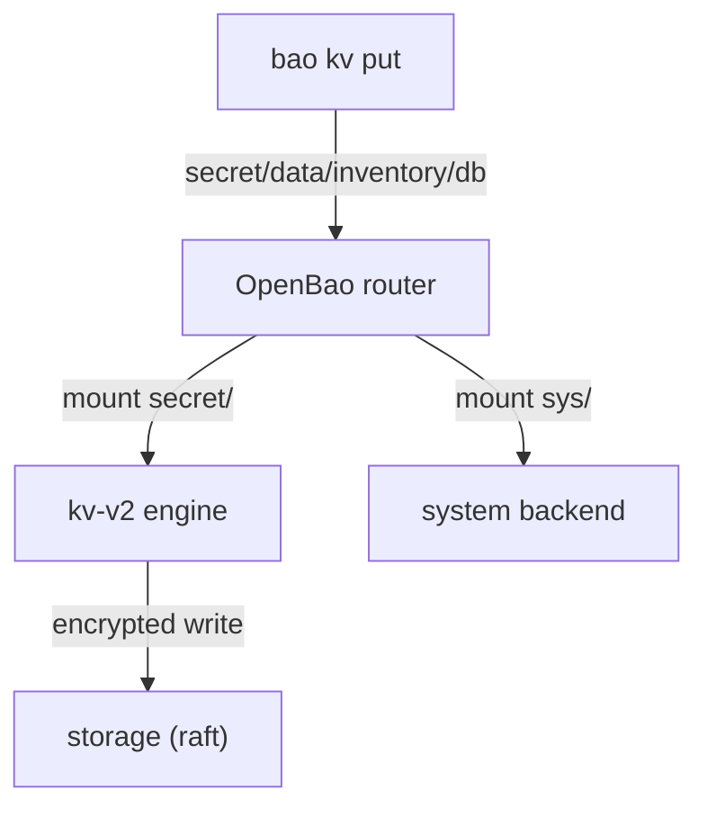

# Secrets Engines And The KV Version 2 Engine

An OpenBao server does nothing with secrets until you tell it how to store them. A new server has no place for a password or an API token. This part enables the KV version 2 engine, writes a first secret, reads it back and changes one field. It also shows the real paths behind the friendly `bao kv` commands, because policies and the API use those paths.

## Connect your terminal to OpenBao

Every command in this module runs on your machine with the `bao` command-line tool. It needs to reach the server and to send a token with each request. A token is the credential OpenBao checks on every request; it decides what the request may do.

<!-- astrona:playground:renew -->

First start the port-forward in a second terminal and leave it running. It makes OpenBao answer on your machine:

```sh
kubectl -n openbao port-forward svc/openbao 8200:8200
```

Then tell `bao` where the server is and which token to use. This lab reads the root token from the Kubernetes Secret `openbao-init`. A root token can do everything, so a real installation revokes it after setup and never keeps it in a Kubernetes Secret; here it saves you the policy work that another course teaches.

```sh
export BAO_ADDR=http://openbao.localtest.me:8200
export BAO_TOKEN=$(kubectl -n openbao get secret openbao-init -o jsonpath='{.data.root-token}' | base64 -d)
bao status
```

`bao status` prints the state of the server. Look for `Sealed` with the value `false`, and for the version `2.7.1`. If the command cannot connect, the port-forward in the other terminal has stopped; start it again.

## Secrets engines and mounts

A secrets engine is a component that stores, creates or encrypts data. OpenBao enables an engine at a path, called a mount, and from then on every request whose path starts with that mount goes to that engine. The same engine type can be mounted several times, at different paths, with different settings.

List the mounts that exist on a new server:

```sh
bao secrets list
```

You see only built-in mounts: `cubbyhole/` (a private space per token), `identity/` (the identity store) and `sys/` (the system backend that configures OpenBao itself). There is no place for application secrets yet. Enable the KV engine, version 2, at the path `secret/`:

```sh
bao secrets enable -path=secret kv-v2
```

The response says that the kv-v2 secrets engine is enabled at `secret/`. Run `bao secrets list` again and the new mount appears with the type `kv` and the option `version:2`.



The diagram shows the OpenBao router sending each request to the engine of the mount its path starts with; the KV engine then writes the data through the encryption barrier to storage.

## Write, read and patch a secret

With the engine mounted, write a first secret. The `-mount` flag names the mount, and the next argument is the path of the secret inside it:

```sh
bao kv put -mount=secret inventory/db username=inventory password=Inv-2026-a
```

The KV engine answers with the metadata of the new version: its `version` is `1`, `created_time` holds the time of the write, and `deletion_time` is empty because nothing is deleted. Read the secret back, and then read only one field:

```sh
bao kv get -mount=secret inventory/db
bao kv get -mount=secret -field=password inventory/db
```

The first command prints two blocks: the metadata of the current version and the data (`username` and `password`). The second command prints only the value `Inv-2026-a`, which is the form scripts use.

Now change the password. `bao kv put` replaces the whole secret: every field you leave out is gone in the new version. `bao kv patch` changes only the fields you name and keeps the rest:

```sh
bao kv patch -mount=secret inventory/db password=Inv-2026-b
bao kv get -mount=secret inventory/db
```

The current version is now `2`, `password` is `Inv-2026-b` and `username` is still `inventory`. Version 1 still exists with the old password; the next part reads it.

## The paths behind the commands

The `bao kv` commands hide where KV version 2 really keeps things. Every secret has two paths: the data of its versions under `secret/data/` and its version history and settings under `secret/metadata/`. Policies and the HTTP API always use these full paths, so you need to know them.

Read the same secret with the generic `bao read` command and the full paths:

```sh
bao read secret/data/inventory/db
bao read secret/metadata/inventory/db
```

The first response holds a `data` map with your fields and a `metadata` map for the current version. The second response holds the settings of the secret (`max_versions`, `cas_required`, `delete_version_after`), the number of the current and the oldest version, and a `versions` map with the creation time of each version. A policy that allows `read` on `secret/data/inventory/*` therefore lets a token read the values, but not change the settings in `secret/metadata/`.

You can now enable an engine at a mount, write, read and patch a secret, and name the paths behind the commands. Every write so far created a new version and kept the old one. The open question is what to do with those versions: how to read an old one, remove a bad one, and make an old one current again.

## Common pitfalls

> [!WARNING]
> - **Using `bao kv put` to change one field.** `put` replaces the whole secret, so every field you leave out disappears from the new version. Use `bao kv patch` to change some fields.
> - **Writing to `secret/inventory/db` in a policy or with `curl`.** For KV version 2 the data path is `secret/data/inventory/db`. Only the `bao kv` commands add `data/` for you.
> - **Forgetting the token.** If `BAO_TOKEN` is empty, every command answers with a permission error. Run the two `export` commands again in each new terminal.
> - **Enabling version 1 by accident.** `bao secrets enable -path=secret kv` creates version 1, which keeps no history. Name the type `kv-v2`.
