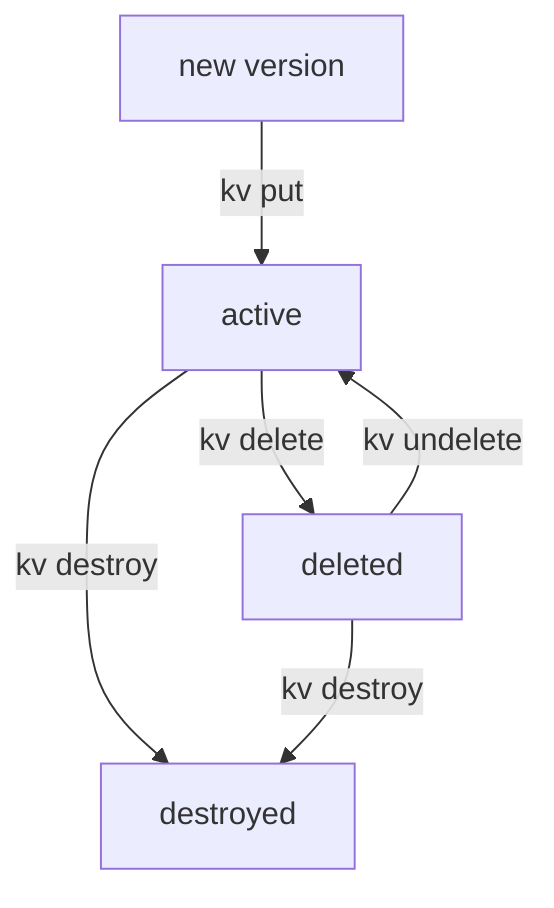

# Versions, Deletes And Rollback

A history of versions is only useful if you can work with it. When someone writes a wrong password, you want the last good one back in seconds. When a secret is deleted by mistake, you want to undo that. When a secret leaked into a version, you want that version gone for good. This part shows how KV version 2 does all three, and which command does what to the stored data.

## Set up the example secret

The commands in this part use the secret `inventory/db` in the KV version 2 mount `secret/`. They need the port-forward (`kubectl -n openbao port-forward svc/openbao 8200:8200`) running in a second terminal.

<!-- astrona:playground:renew -->

Point `bao` at the server with the lab-only root token, and make sure the mount and the secret exist. If the mount is already there, the `enable` command answers with an error that the path is in use, and you can ignore it:

```sh
export BAO_ADDR=http://openbao.localtest.me:8200
export BAO_TOKEN=$(kubectl -n openbao get secret openbao-init -o jsonpath='{.data.root-token}' | base64 -d)
bao secrets enable -path=secret kv-v2
bao kv put -mount=secret inventory/db username=inventory password=Inv-2026-a
bao kv put -mount=secret inventory/db username=inventory password=Inv-2026-b
```

Now write a bad version, the kind of mistake this part is about. Someone set a placeholder instead of the real password:

```sh
bao kv put -mount=secret inventory/db username=inventory password=CHANGEME
```

The secret has at least three versions now, and the newest one holds `CHANGEME`.

## Reading the history

The KV engine keeps the data of every version until a setting or a command removes it. Read an older version with the `-version` flag, and read the whole history from the metadata:

```sh
bao kv get -mount=secret -version=2 inventory/db
bao kv metadata get -mount=secret inventory/db
```

The first command prints the data of version 2, with the password `Inv-2026-b`. The second command prints the settings of the secret and one block per version, each with its `created_time`, its `deletion_time` and a `destroyed` field. This is where you find the last good version before you change anything.

## Three ways to remove data

KV version 2 has three commands that remove data, and they are very different. The difference matters most when a secret leaked: a deleted version can come back, a destroyed one cannot.

| Command | What happens to the data | Can it come back? |
| --- | --- | --- |
| `bao kv delete` | Marks a version deleted and sets `deletion_time`; the data stays in storage | Yes, with `bao kv undelete` |
| `bao kv destroy` | Removes the data of the named versions from storage and sets `destroyed` to `true` | No |
| `bao kv metadata delete` | Removes the whole secret: every version and all its metadata | No |

Try the soft delete on the current version, read it, and undo it. Replace `3` with the number of the current version if your secret has more versions:

```sh
bao kv delete -mount=secret inventory/db
bao kv get -mount=secret inventory/db
bao kv undelete -mount=secret -versions=3 inventory/db
```

After the delete, `bao kv get` returns no data for the current version, and its metadata shows a `deletion_time`. After the undelete, the same version is readable again, with the same version number: undelete does not write anything new.



The diagram shows the states of one version: a deleted version can return to active, but a destroyed version has no data left and stays destroyed.

## Rolling back a bad write

The current version still holds `CHANGEME`. You could write the good password again by hand, but then you must know it, and a typo starts the problem over. `bao kv rollback` copies the data of an older version into a new version:

```sh
bao kv rollback -mount=secret -version=2 inventory/db
bao kv get -mount=secret inventory/db
```

The rollback writes a new version, one number higher than the current one, with the data of version 2. The bad version stays in the history, so you can still see what happened. If the bad version held something sensitive, remove its data for good:

```sh
bao kv destroy -mount=secret -versions=3 inventory/db
```

Run `bao kv metadata get -mount=secret inventory/db` once more: version 3 shows `destroyed` as `true`, and the current version is the rollback. Roll back only to a version that still has its data; a destroyed version has nothing left to copy.

You can now read any version, tell a delete from a destroy, undelete a version and roll back a bad write. The history of a secret still grows with every write, though, and nothing stops two people from overwriting each other. The open question is how to limit that history and protect a secret from lost updates.

## Common pitfalls

> [!WARNING]
> - **Writing the good value again instead of rolling back.** It works only if you remember the value exactly. `bao kv rollback -version=N` copies it from the history.
> - **Deleting a leaked version instead of destroying it.** A soft delete keeps the data in storage, and anyone allowed to undelete can read it again. Use `bao kv destroy`.
> - **Deleting the metadata to "clean up".** `bao kv metadata delete` removes every version of the secret, including the good ones, and cannot be undone.
> - **Undeleting the wrong version.** `-versions` takes version numbers, not "the last one". Read `bao kv metadata get` first and name the version you mean.
