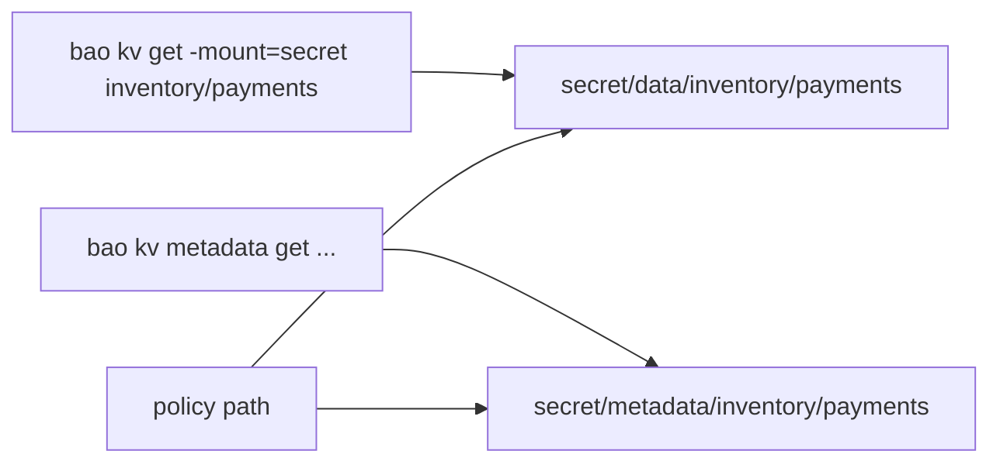

# Patching, Listing, Custom Metadata And The API Paths

The first three parts used the `bao kv` commands, which hide the real paths of the engine. Policies, the HTTP API and every tool that is not the CLI use those real paths. This part looks at them, lists secrets, changes one field without touching the others, and adds your own notes to the metadata of a secret.

## Set up your terminal

The commands in this part need the port-forward in a second terminal and the KV version 2 mount `secret/`.

<!-- astrona:playground:renew -->

Start the port-forward in a second terminal and leave it running:

```sh
kubectl -n openbao port-forward svc/openbao 8200:8200
```

Point `bao` at the server with the lab-only root token:

```sh
export BAO_ADDR=http://openbao.localtest.me:8200
export BAO_TOKEN=$(kubectl -n openbao get secret openbao-init -o jsonpath='{.data.root-token}' | base64 -d)
```

```sh
bao secrets enable -path=secret kv-v2
bao kv put -mount=secret inventory/payments api_key=pay-live-1234 owner=payments-team
bao kv put -mount=secret inventory/orders db_user=orders
bao kv put -mount=secret shared/smtp host=mail.example password=smtp-1
```

If the mount and the secrets already exist, ignore the errors.

## Patch one field

`bao kv put` replaces the whole secret. `bao kv patch` changes only the fields you name and keeps the rest:

```sh
bao kv patch -mount=secret inventory/payments api_key=pay-live-5678
bao kv get -mount=secret inventory/payments
```

The secret still has `owner` and has a new `api_key`, as a new version. A patch needs the `patch` capability on the data path; a token that has only `update` cannot patch. If a client cannot use the patch request, `bao kv patch -method=rw` reads the secret and writes it back, which needs `read` and `update` instead.

## List secrets

`bao kv list` shows the names under a path. A name that ends with `/` is a folder with more secrets below it:

```sh
bao kv list -mount=secret
bao kv list -mount=secret inventory
```

The first command shows `inventory/` and `shared/`. The second shows `orders` and `payments`. Listing reads the metadata path and needs the `list` capability there. It shows names only; reading a value needs a separate `read`.

## The real paths

For a mount `secret/` and a secret `inventory/payments`, the engine uses these paths:

| Action | HTTP and path | Capability |
| --- | --- | --- |
| Read a version | `GET secret/data/inventory/payments` | `read` |
| Write a version | `POST secret/data/inventory/payments` | `create` or `update` |
| Patch | `PATCH secret/data/inventory/payments` | `patch` |
| List names | `LIST secret/metadata/inventory` | `list` |
| Read metadata | `GET secret/metadata/inventory/payments` | `read` |
| Delete the latest version | `DELETE secret/data/inventory/payments` | `delete` |
| Delete versions | `POST secret/delete/inventory/payments` | `update` |
| Undelete versions | `POST secret/undelete/inventory/payments` | `update` |
| Destroy versions | `POST secret/destroy/inventory/payments` | `update` |
| Delete all metadata | `DELETE secret/metadata/inventory/payments` | `delete` |

A policy that lets an application read one secret therefore names the `data` path, not the path you type in the CLI:

```hcl
path "secret/data/inventory/payments" {
  capabilities = ["read"]
}
```

A policy written for `secret/inventory/payments` matches nothing and the application gets `permission denied`.

## Call the API directly

The same read as plain HTTP:

```sh
curl -s -H "X-Vault-Token: $BAO_TOKEN" "$BAO_ADDR/v1/secret/data/inventory/payments" | jq '.data'
curl -s -H "X-Vault-Token: $BAO_TOKEN" "$BAO_ADDR/v1/secret/data/inventory/payments?version=1" | jq '.data.data'
```

The answer has two objects: `.data.data` holds the values and `.data.metadata` holds the version, the creation time and whether it is deleted. The `version` query parameter selects an older version.

## Custom metadata

The metadata of a secret can carry your own key/value notes, which are not secret and are shown to anyone who can read the metadata. They suit information such as the owner or a ticket number:

```sh
bao kv metadata patch -mount=secret -custom-metadata=owner=payments-team -custom-metadata=ticket=OPS-114 inventory/payments
bao kv metadata get -mount=secret inventory/payments
```

`bao kv metadata patch` changes only the settings you pass. `bao kv metadata put` writes all settings at once, so settings you leave out go back to their defaults. Never put a value in custom metadata that should stay secret.



The diagram shows that the CLI commands map to the `data` and `metadata` paths, and that a policy has to name those paths.

You can now work with the engine through its real paths. That completes the KV version 2 engine.

## Common pitfalls

> [!WARNING]
> - **Writing a policy for `secret/inventory/payments`.** The data lives at `secret/data/...`.
> - **Using `put` to change one field.** It drops the other fields; use `patch`.
> - **Giving `list` on `secret/metadata/` to an application.** It then sees the names of all secrets.
> - **Storing a secret in custom metadata.** It is readable by anyone who can read the metadata.
