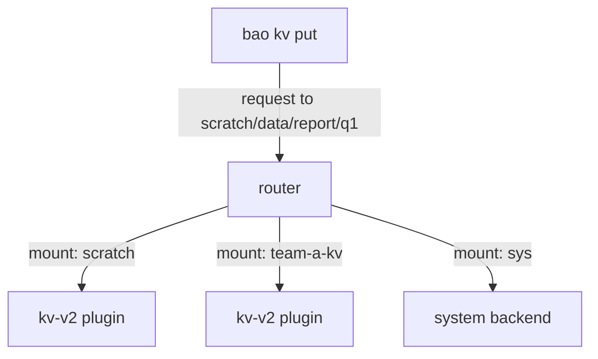

# Mounts, Paths And Engine Types

OpenBao does nothing with secrets until an engine is enabled. An engine is a plugin that stores, generates or encrypts data, and OpenBao attaches it to a path so that requests to that path reach the plugin. This part shows the mount table, enables two engines at paths you choose, and reads the settings of each.

## Set up your terminal

The commands in this part need only the built-in mounts.

<!-- astrona:playground:renew -->

Start the port-forward in a second terminal and leave it running:

```sh
kubectl -n openbao port-forward svc/openbao 8200:8200
```

Point `bao` at the server with the lab-only root token:

```sh
export BAO_ADDR=http://openbao.localtest.me:8200
export BAO_TOKEN=$(kubectl -n openbao get secret openbao-init -o jsonpath='{.data.root-token}' | base64 -d)
```

## Read the mount table

The mount table is the list of paths that currently lead to an engine. `bao secrets list` prints it, and `-detailed` adds the settings of each mount:

```sh
bao secrets list
bao secrets list -detailed
```

A fresh server shows three mounts. `cubbyhole/` is a private store for each token. `identity/` holds entities and groups. `sys/` is the system backend, the API that manages OpenBao itself, including the mount table. Each row shows the path, the engine type, an accessor and a description. The accessor is a stable ID such as `kv_1a2b3c4d`; it stays the same when the mount is moved, which is why audit logs and policies for tokens can refer to it.

The same list is available over the API. Every `bao` command is a request to a path:

```sh
bao read sys/mounts
```

## Enable an engine at a path

`bao secrets enable` attaches an engine to a path. By default the path is the engine type, so `bao secrets enable kv` would mount at `kv/`. Almost always you choose the path with `-path`, and add a description:

```sh
bao secrets enable -path=team-a-kv -description="Secrets of team A" kv-v2
bao secrets enable -path=scratch -description="Temporary data" kv-v2
```

The last word is the engine type. `kv-v2` is KV version 2: the `kv` engine with its `version` option set to `2`. The same engine can be mounted many times at different paths, and each mount has its own data and its own settings. One mount per team or per application keeps policies short, because a policy can then grant a whole mount.

Check what was created:

```sh
bao secrets list -detailed
```

Both new rows show type `kv`, and the options column shows `map[version:2]`.

## Use a mount

A mount path is the first part of every request to the engine. For KV version 2 the CLI hides the `data/` segment when you use the `-mount` flag:

```sh
bao kv put -mount=scratch report/q1 owner=finance status=draft
bao kv get -mount=scratch report/q1
```

The first command writes a secret named `report/q1` in the mount `scratch`. In API terms the path is `scratch/data/report/q1`. Writing to a path where no mount exists fails: OpenBao answers that no handler is configured for the path, or that the mount is not found.



The diagram shows that OpenBao's router uses the first path segment to choose the engine, so two KV mounts never see each other's data.

You can now read the mount table, enable an engine at a path you choose, and write to it. The mounts still use the default settings, and the next question is how to change those settings after the mount exists.

## Common pitfalls

> [!WARNING]
> - **Enabling KV without the version.** `bao secrets enable kv` creates version 1, which keeps no history. Use `kv-v2` or `-version=2`.
> - **Using the same path for two purposes.** A path can hold one mount. Paths also cannot be nested inside another mount, so `scratch/` and `scratch/old/` cannot both be mounts.
> - **Treating the description as a name.** The description is only text for people. Policies and requests use the path.
