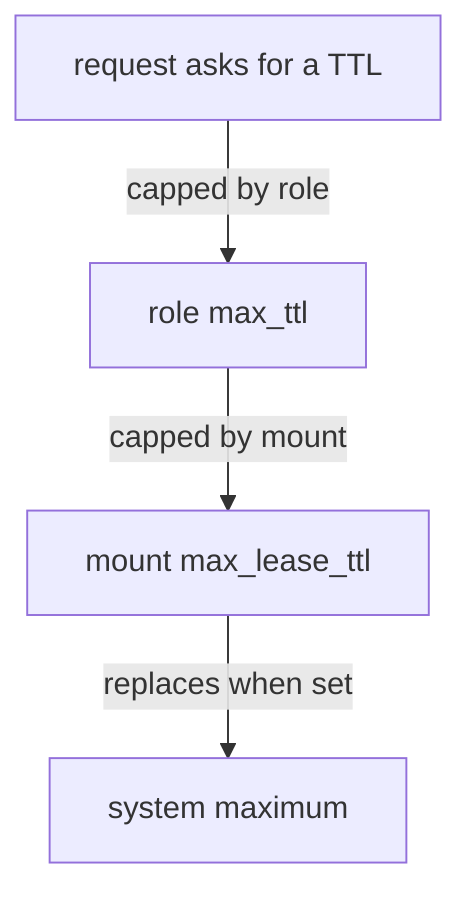

# Tuning A Mount

A mount has settings that apply to every request it handles: how long leases may live, whether its name is shown to callers without a token, and which headers pass through. Changing them is called tuning. This part reads the settings of a mount, changes the lease limits and the description, and explains which limit wins when several are set.

## Set up your terminal

The commands in this part need the mount `team-a-kv/` from the previous steps. If it does not exist, enable it first.

<!-- astrona:playground:renew -->

Start the port-forward in a second terminal and leave it running:

```sh
kubectl -n openbao port-forward svc/openbao 8200:8200
```

Point `bao` at the server with the lab-only root token:

```sh
export BAO_ADDR=http://openbao.localtest.me:8200
export BAO_TOKEN=$(kubectl -n openbao get secret openbao-init -o jsonpath='{.data.root-token}' | base64 -d)
```

```sh
bao secrets enable -path=team-a-kv -description="Secrets of team A" kv-v2
```

If the path is already in use, OpenBao answers with an error and you can go on.

## Read the settings of a mount

Mount settings are in the `config` block of `sys/mounts/<path>/tune`:

```sh
bao read sys/mounts/team-a-kv/tune
```

The response has `default_lease_ttl` and `max_lease_ttl`. A value of `0` means that the mount does not set its own limit and uses the system value. OpenBao's system default lease TTL is 32 days (768 hours), and the system maximum is the same.

## Change the lease limits

A lease is the time a dynamic secret is valid. KV stores static data and has no leases of its own, but the same two settings exist on every mount, and engines such as `database` and `pki` use them. Learning them on any mount is therefore worth the time. The CLI command is `bao secrets tune`:

```sh
bao secrets tune -default-lease-ttl=1h -max-lease-ttl=24h team-a-kv
bao read sys/mounts/team-a-kv/tune
```

`default_lease_ttl` is the lifetime a lease gets when the request does not ask for one. `max_lease_ttl` is the longest any lease on this mount can have, even with renewals. The response now shows `3600` and `86400`, in seconds.

## Which limit wins

Several places can set a lifetime: the server configuration, the mount, the role and the request. The rules are:

1. A request or role can ask for a shorter time than the mount default, and gets it.
2. A request that asks for more than the mount `max_lease_ttl` gets the maximum, not an error.
3. A non-zero mount value replaces the system value for that mount. It can be lower or higher than the system value, which is why a PKI mount for a root CA is tuned to many years.

A rule to remember: tuning changes the limits of that mount only. It never changes another mount.

## Change the description and visibility

The description is text. The listing visibility decides whether the mount appears in the UI mount list for callers without a token:

```sh
bao secrets tune -description="Secrets of team A (owner: alice)" team-a-kv
bao secrets tune -listing-visibility=hidden team-a-kv
```

`hidden` is the default. `unauth` shows the mount name and description to anyone who calls `sys/internal/ui/mounts` without a token, which is useful for a login page and nothing else.

Other tune options control which HTTP headers pass to the engine (`-passthrough-request-headers`) and which headers the engine may return (`-allowed-response-headers`). Audit logs normally hide request and response values by hashing them with HMAC-SHA-256 (a keyed one-way hash); `-audit-non-hmac-request-keys` lists keys that the log may show in clear. Use that only for values that are not secret.



The diagram shows that a request is cut down by the role and by the mount maximum, and that the mount value takes the place of the system maximum when it is set.

You can now read and change the settings of a mount. A mount path can also change, and that is more dangerous than a setting, because policies and applications refer to the path.

## Common pitfalls

> [!WARNING]
> - **Reading `0` as "no lifetime".** `0` means "use the system value". It does not mean "never expire".
> - **Expecting a mount setting to reach other mounts.** A tuned value applies to that mount only.
> - **Putting secrets in the description.** The description can be shown to callers without a token when the visibility is `unauth`.
