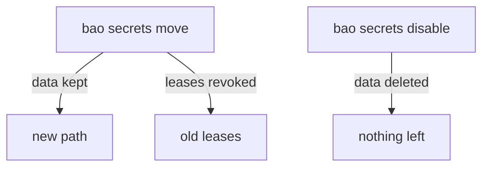

# Moving And Disabling Mounts

Two mount actions are not harmless. Moving a mount changes the path that applications and policies use. Disabling a mount destroys everything stored in it. This part moves a mount with its data intact, shows what stops working after the move, and disables a mount on purpose.

## Set up your terminal

The commands in this part need a KV version 2 mount `scratch/` with one secret, and a second mount `old-reports/`.

<!-- astrona:playground:renew -->

Start the port-forward in a second terminal and leave it running:

```sh
kubectl -n openbao port-forward svc/openbao 8200:8200
```

Point `bao` at the server with the lab-only root token:

```sh
export BAO_ADDR=http://openbao.localtest.me:8200
export BAO_TOKEN=$(kubectl -n openbao get secret openbao-init -o jsonpath='{.data.root-token}' | base64 -d)
```

Create them. If a mount already exists, you can ignore the error from its line:

```sh
bao secrets enable -path=scratch kv-v2
bao secrets enable -path=old-reports kv-v2
bao kv put -mount=scratch report/q1 owner=finance status=draft
```

## Move a mount

`bao secrets move` renames a mount path and keeps its data, its configuration and its accessor. The arguments are the old path and the new path:

```sh
bao secrets move scratch/ apps/
bao secrets list
bao kv get -mount=apps report/q1
```

The mount `scratch/` is gone, `apps/` is in its place, and the secret `report/q1` has the same fields as before. OpenBao runs the move in the background; for a large mount you can check it with `bao read sys/remount/status/<migration id>`, where the ID is in the response of the move.

A move has effects you must plan for:

- Every request to the old path now fails. Applications must switch to the new path.
- Policies name paths, not mounts, so a policy for `scratch/data/*` no longer matches anything. Update the policies.
- OpenBao revokes the leases of the mount during the move, because lease IDs contain the old path. KV has no leases, but a database or PKI mount would lose its credentials.
- You cannot move a system mount such as `sys/` or `identity/`, and you cannot move a mount inside another mount.

## Disable a mount

`bao secrets disable` removes a mount and **permanently deletes every secret and setting stored in it**. There is no undo, and no soft delete as there is for a KV version. For a mount with leases, OpenBao revokes them first.

```sh
bao secrets disable old-reports/
bao secrets list
```

The mount is gone, and `bao kv get -mount=old-reports report/q1` would now fail. If you need a copy of the data, read it out before you disable the mount, for example with `bao kv get -format=json` for each secret.



The diagram shows that a move keeps the data and revokes leases, and that disable keeps nothing.

You can now rename a mount without losing its data and remove one deliberately. Together with tuning, these are the three actions a mount lab asks for, and the next lab does exactly that.

## Common pitfalls

> [!WARNING]
> - **Disabling instead of moving.** Disable deletes all data. Move keeps it.
> - **Forgetting the policies.** After a move, tokens keep their policies but the policies point to a path that no longer exists, so every request is denied.
> - **Moving a mount with active leases.** The leases are revoked, and applications holding them lose access at once.
> - **Leaving the trailing slash out and mixing paths.** Both `apps` and `apps/` work for the CLI, but write the slash in scripts so that the old and new paths look the same.

## Your mission: Move And Tune Secrets Engine Mounts

You can now list, tune, move and disable mounts without losing the data you want to keep. The graded lab gives you a server with a mount at the wrong path, an unused mount and a missing lease limit, and asks you to fix all three while the stored secret stays readable.

The lab runs in its own cluster, so first pause your playground. Nothing in it is lost:

```sh
astrona stop ats-114-playground-010-02
```

Then start the lab:

```sh
astrona run --git ssh://git@github.com/astrona-io/ATS114.git -c sections/section-010/module-02/labs/lab-01
```

The task is on the next page. Solve it on your own first. When you think you are done, send it for grading:

```sh
astrona submit -c sections/section-010/module-02/labs/lab-01
```

When the lab is done, remove it and start your playground again:

```sh
astrona destroy ats-114-lab-010-02
astrona start ats-114-playground-010-02
```
