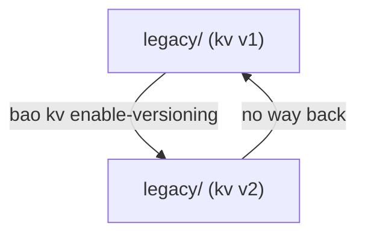

# KV Version 1 And Upgrading To Version 2

The KV engine exists in two versions, and the version is a property of the mount. Older mounts, or mounts created with a bare `kv`, are version 1. This part compares the two, shows how the paths differ, and upgrades a version 1 mount to version 2 in place.

## Set up your terminal

The commands in this part use a version 1 mount named `legacy/`.

<!-- astrona:playground:renew -->

Start the port-forward in a second terminal and leave it running:

```sh
kubectl -n openbao port-forward svc/openbao 8200:8200
```

Point `bao` at the server with the lab-only root token:

```sh
export BAO_ADDR=http://openbao.localtest.me:8200
export BAO_TOKEN=$(kubectl -n openbao get secret openbao-init -o jsonpath='{.data.root-token}' | base64 -d)
```

Create it and write one secret:

```sh
bao secrets enable -path=legacy -version=1 kv
bao kv put -mount=legacy db/password value=old-secret
```

## Version 1 keeps one value

KV version 1 stores exactly what you write at a path. A second write replaces the first, and a delete removes the data at once. There are no versions, no soft deletes and no check-and-set.

```sh
bao kv put -mount=legacy db/password value=new-secret
bao kv get -mount=legacy db/password
bao kv metadata get -mount=legacy db/password
```

The read returns `new-secret`. The metadata command fails, because version 1 has no metadata endpoint. In the API, a version 1 secret lives at `legacy/db/password`, with no `data/` segment. A version 2 secret lives at `<mount>/data/<path>`, and its settings at `<mount>/metadata/<path>`. This is why a policy written for one version does not work for the other.

| Feature | KV version 1 | KV version 2 |
| --- | --- | --- |
| Versions of a secret | one | many, up to `max_versions` |
| Delete | removes the data | soft delete, undelete, destroy |
| Check-and-set | no | yes |
| API path | `<mount>/<path>` | `<mount>/data/<path>` |
| Storage per write | smaller | larger, because of history |

## Upgrade in place

`bao kv enable-versioning` turns a version 1 mount into a version 2 mount. The data stays, and each secret becomes version 1 of itself:

```sh
bao kv enable-versioning legacy/
bao kv metadata get -mount=legacy db/password
```

The metadata command now works and shows `current_version` `1`. The upgrade runs in the background, and OpenBao answers requests with an error until it finishes; it is quick for small mounts. Two things change at once: the API paths gain `data/` and `metadata/`, and policies written for version 1 stop matching. Update policies before applications switch, or the applications get permission errors.

There is no command to go back from version 2 to version 1. To do that, you read all secrets and write them into a new version 1 mount.

## Choose a version for a new mount

Use version 2 for new mounts. It costs more storage, and it saves the day when a write is wrong. Use version 1 only when a client or tool expects it. Check a mount's version with `bao secrets list -detailed`: the options column shows `map[version:2]` for version 2, and nothing or `version:1` for version 1.



The diagram shows that the upgrade has one direction.

You can now tell the two versions apart by path, features and mount options, and upgrade a mount safely. This closes the work on mounts: you can enable, tune, move, disable and upgrade them.

## Common pitfalls

> [!WARNING]
> - **Forgetting `data/` in policies after the upgrade.** A policy that grants `legacy/*` does not grant `legacy/data/*`.
> - **Expecting history from existing secrets.** Upgraded secrets start at version 1; the old overwritten values are gone.
> - **Mixing the path styles.** `bao kv get -mount=legacy db/password` works on both versions. A raw API call must add `data/` on version 2.
