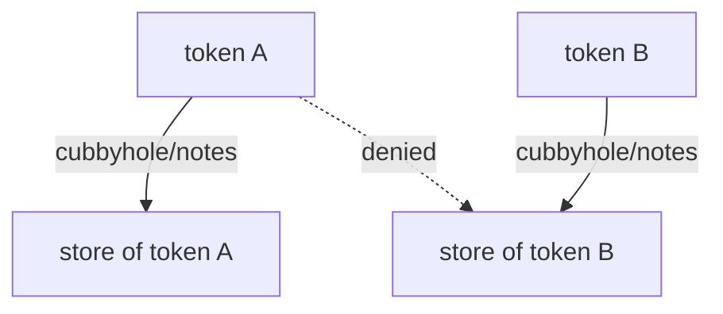

# The Cubbyhole Engine

Most secrets engines store data for many callers, and a policy decides who may read it. The cubbyhole engine is different: every token gets its own private store, and no policy can open another token's store. This part writes and reads the cubbyhole of two tokens and shows what happens to it when a token ends.

## Set up your terminal

The cubbyhole engine is enabled by default at `cubbyhole/`, so the commands need no preparation.

<!-- astrona:playground:renew -->

Start the port-forward in a second terminal and leave it running:

```sh
kubectl -n openbao port-forward svc/openbao 8200:8200
```

Point `bao` at the server with the lab-only root token:

```sh
export BAO_ADDR=http://openbao.localtest.me:8200
export BAO_TOKEN=$(kubectl -n openbao get secret openbao-init -o jsonpath='{.data.root-token}' | base64 -d)
```

## Write to your own cubbyhole

The cubbyhole is a simple key/value store with no versions. Write to it and read it back with the root token:

```sh
bao write cubbyhole/notes text="visible only to this token"
bao read cubbyhole/notes
```

The data you wrote is stored for the token in `BAO_TOKEN`. The path `cubbyhole/notes` is the same for every token, but each token sees its own data under it.

## See that another token cannot read it

Create a second token. `bao token create` prints a JSON document when you ask for it, and the token is in `.auth.client_token`:

```sh
OTHER_TOKEN=$(bao token create -policy=default -ttl=10m -format=json | jq -r '.auth.client_token')
BAO_TOKEN=$OTHER_TOKEN bao read cubbyhole/notes
```

The read fails with an error that no value is found. The second token has its own, empty cubbyhole. The root token, which can read almost everything, cannot read the cubbyhole of the second token either, and the second token cannot read the cubbyhole of the root token.

Write something with the second token to prove the two stores are separate, then read it with each token:

```sh
BAO_TOKEN=$OTHER_TOKEN bao write cubbyhole/notes text="second token data"
BAO_TOKEN=$OTHER_TOKEN bao read cubbyhole/notes
bao read cubbyhole/notes
```

The second read shows `second token data`. The third read, with the root token, still shows `visible only to this token`.

## The cubbyhole ends with its token

A cubbyhole belongs to the token and has the same life as the token. When the token expires or is revoked, OpenBao deletes the cubbyhole and everything in it. There is no way to read the data afterwards:

```sh
bao token revoke "$OTHER_TOKEN"
BAO_TOKEN=$OTHER_TOKEN bao read cubbyhole/notes
```

The second command fails because the token no longer exists. The cubbyhole cannot be disabled, moved or enabled at a second path.



The diagram shows that the same path leads to a different store for each token, and that one token cannot reach the store of another.

You now know the property that response wrapping depends on: a store that only one token can open and that disappears with that token. The next part uses that store to carry a secret from one caller to another.

## Common pitfalls

> [!WARNING]
> - **Using the cubbyhole for shared data.** Only the token that wrote the data can read it. Use KV for data that several callers need.
> - **Expecting the data to survive.** When the token expires, the cubbyhole is deleted.
> - **Expecting the root token to read everything.** The root token cannot read the cubbyhole of another token.
