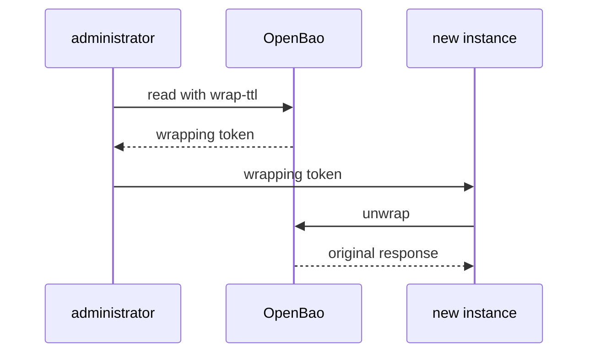

# Response Wrapping

Response wrapping changes how a response travels. Instead of returning the secret to the caller, OpenBao puts the response into the cubbyhole of a new single-use token and returns only that token. This part wraps a KV secret, reads the wrapping details and unwraps it once.

## Set up your terminal

The commands in this part need a KV version 2 mount `secret/` with one secret.

<!-- astrona:playground:renew -->

Start the port-forward in a second terminal and leave it running:

```sh
kubectl -n openbao port-forward svc/openbao 8200:8200
```

Point `bao` at the server with the lab-only root token:

```sh
export BAO_ADDR=http://openbao.localtest.me:8200
export BAO_TOKEN=$(kubectl -n openbao get secret openbao-init -o jsonpath='{.data.root-token}' | base64 -d)
```

Create them. If the mount already exists, ignore the error from the first line:

```sh
bao secrets enable -path=secret kv-v2
bao kv put -mount=secret inventory/api api-key=abc-123-def
```

## Ask for a wrapped response

Any request can be wrapped by adding a wrap TTL. The wrap TTL is the time the wrapping token stays valid. The flag is `-wrap-ttl` on every `bao` command that sends a request:

```sh
bao read -wrap-ttl=5m secret/data/inventory/api
```

The response does not contain the secret. It contains `wrapping_token`, `wrapping_token_ttl` (300 seconds), `wrapping_token_creation_time`, `wrapping_token_creation_path` (here `secret/data/inventory/api`) and `wrapped_accessor`. Keep the token in a variable. The `-field` flag prints a single value:

```sh
WRAP_TOKEN=$(bao read -wrap-ttl=5m -field=wrapping_token secret/data/inventory/api)
```

## Unwrap it

`bao unwrap` takes the wrapping token as its argument and returns the original response, exactly as if the caller had read the secret:

```sh
bao unwrap -format=json "$WRAP_TOKEN" | jq '.data.data'
```

The output shows `api-key` with the value `abc-123-def`. The caller that unwraps needs no policy of its own: the wrapping token is the authority. That is why the token must be handed over by a safe route and used quickly.

## A wrapping token works once

The wrapping token is single-use. OpenBao deletes it, and with it the cubbyhole that holds the response, as soon as the unwrap succeeds:

```sh
bao unwrap "$WRAP_TOKEN"
```

The second call fails with an error that the wrapping token is not valid or does not exist. The same happens when the wrap TTL has passed. A token that cannot be unwrapped has either expired or been used by someone else, and the second case is a security event.

## Wrap without reading a secret

You can also wrap data that is not stored anywhere. The endpoint `sys/wrapping/wrap` wraps the JSON body it receives:

```sh
bao write -wrap-ttl=2m sys/wrapping/wrap one-time-code=551234
```

The response is a wrapping token again, and unwrapping it returns `one-time-code`. This is the simplest way to send a short value to another person: the value is not in the chat, only the token is.



The diagram shows that only the wrapping token travels between people, and that the secret goes straight from OpenBao to the new instance.

You can now wrap a response and unwrap it once. The open question is how the receiver knows that the token is the right one, and what to do when the unwrap fails.

## Common pitfalls

> [!WARNING]
> - **Forgetting `-wrap-ttl`.** Without it, the response contains the secret in clear and nothing is wrapped.
> - **Setting a long wrap TTL.** The shorter the lifetime, the shorter the time a stolen token can be used. Use minutes, not days.
> - **Unwrapping to test.** Testing consumes the token. The real receiver then gets an error.
