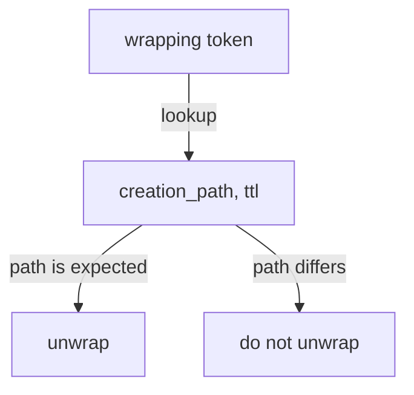

# Verifying A Wrapping Token

A single-use token only protects the secret if the receiver checks two things before unwrapping: that the token was created for the expected secret, and that nobody used it first. This part looks up a wrapping token without consuming it, rewraps it, and explains what to do when an unwrap fails.

## Set up your terminal

The commands in this part need the mount `secret/` with the secret `inventory/api`.

<!-- astrona:playground:renew -->

Start the port-forward in a second terminal and leave it running:

```sh
kubectl -n openbao port-forward svc/openbao 8200:8200
```

Point `bao` at the server with the lab-only root token:

```sh
export BAO_ADDR=http://openbao.localtest.me:8200
export BAO_TOKEN=$(kubectl -n openbao get secret openbao-init -o jsonpath='{.data.root-token}' | base64 -d)
```

```sh
bao secrets enable -path=secret kv-v2
bao kv put -mount=secret inventory/api api-key=abc-123-def
```

If the mount exists, the first command fails and you can go on.

## Look up a token without using it

`sys/wrapping/lookup` returns the facts about a wrapping token and does not consume it. It needs no authentication, so a receiver without any other access can call it:

```sh
WRAP_TOKEN=$(bao read -wrap-ttl=5m -field=wrapping_token secret/data/inventory/api)
bao write -format=json sys/wrapping/lookup token="$WRAP_TOKEN" | jq '.data'
```

The response has `creation_path`, `creation_time` and `creation_ttl`. The receiver compares `creation_path` with the path it expects (`secret/data/inventory/api`). If a different path appears, the token was made for something else, or by someone who wants the receiver to unwrap a response of their choice. Do not unwrap it.

The lookup also shows whether the token is still valid. A token that was used or has expired makes the lookup fail with the same error as a failed unwrap.

## What a failed unwrap means

Two causes give the same error. Either the wrap TTL passed, or someone unwrapped the token first. The receiver cannot tell the two apart from the error alone, so the rule is:

1. Report it to the person who sent the token.
2. Treat the secret as exposed when the TTL had not passed.
3. Rotate the secret and send a new wrapping token.

The audit log shows who unwrapped a token and when, because every unwrap is a request. Use `wrapped_accessor`, which the wrap response also returns, to find the matching log entries without knowing the token.

## Rewrap a token

`sys/wrapping/rewrap` replaces a wrapping token with a new one that holds the same response. The old token stops working at once. The administrator can use it to rotate a token that the receiver has not used yet, for example when the token was sent over a channel that is no longer trusted:

```sh
NEW_TOKEN=$(bao write -format=json sys/wrapping/rewrap token="$WRAP_TOKEN" | jq -r '.wrap_info.token')
bao write -format=json sys/wrapping/lookup token="$NEW_TOKEN" | jq '.data'
```

Compare the lookup of the new token with the lookup of the old one. A strict receiver that checks the creation path should be told which path to expect after a rewrap.



The diagram shows the receiver's decision: look up first, unwrap only if the creation path is the expected one.

You can now check where a wrapping token came from and react to a failed unwrap. The last step in the module is wrapping responses of engines that create credentials, and limiting how long a caller may keep a wrapping token.

## Common pitfalls

> [!WARNING]
> - **Skipping the lookup.** A wrapping token with a different creation path is a sign of an attack. The lookup is free.
> - **Reading a failed unwrap as a typo.** Treat it as possible exposure when the TTL has not passed.
> - **Sending the token and the creation path in the same message.** Send the expected path through another route.

## Your mission: Hand Over A Secret With Response Wrapping

You can now wrap a response, check a wrapping token and unwrap it exactly once. The graded lab asks you to wrap a secret for a new instance and to unwrap a token that a partner sent you, then store its content, while every token is used the right number of times.

The lab runs in its own cluster, so first pause your playground. Nothing in it is lost:

```sh
astrona stop ats-114-playground-010-03
```

Then start the lab:

```sh
astrona run --git ssh://git@github.com/astrona-io/ATS114.git -c sections/section-010/module-03/labs/lab-01
```

The task is on the next page. Solve it on your own first. When you think you are done, send it for grading:

```sh
astrona submit -c sections/section-010/module-03/labs/lab-01
```

When the lab is done, remove it and start your playground again:

```sh
astrona destroy ats-114-lab-010-03
astrona start ats-114-playground-010-03
```
