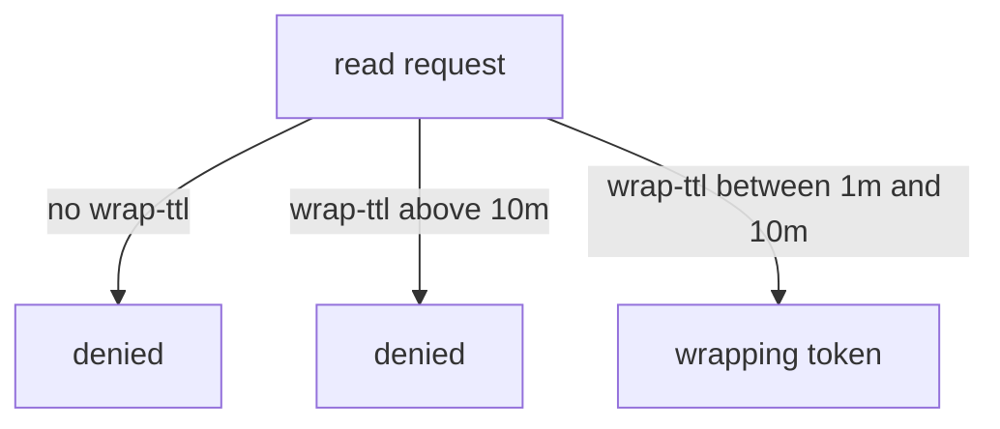

# Wrapping Credentials From Other Engines

Wrapping works for every response, so it protects credentials as well as static secrets: a database user and password, a certificate private key, a new token. This part wraps a token and a database response and then limits wrapping lifetimes with a policy.

## Set up your terminal

The commands in this part need only the root token.

<!-- astrona:playground:renew -->

Start the port-forward in a second terminal and leave it running:

```sh
kubectl -n openbao port-forward svc/openbao 8200:8200
```

Point `bao` at the server with the lab-only root token:

```sh
export BAO_ADDR=http://openbao.localtest.me:8200
export BAO_TOKEN=$(kubectl -n openbao get secret openbao-init -o jsonpath='{.data.root-token}' | base64 -d)
```

## Wrap a new token

A common start-up pattern is to wrap the token that a new instance will use. Create a token with a policy and a wrap TTL, and the token never appears in your terminal:

```sh
WRAP_TOKEN=$(bao token create -policy=default -ttl=1h -wrap-ttl=5m -field=wrapping_token)
bao write -format=json sys/wrapping/lookup token="$WRAP_TOKEN" | jq '.data.creation_path'
```

The creation path is `auth/token/create`. The instance unwraps and finds its token in `.auth.client_token` of the response:

```sh
INSTANCE_TOKEN=$(bao unwrap -format=json "$WRAP_TOKEN" | jq -r '.auth.client_token')
```

Only the instance holds the token. The administrator never saw it.

## Wrap a dynamic credential

The same flag wraps credentials from any engine that returns them. With a database role, the command would be `bao read -wrap-ttl=5m database/creds/inventory-readonly`. The user is created when the request is made. The lease on the credential starts at that moment, not when the receiver unwraps it. Choose a lease long enough for the hand-over, and revoke the lease if the token is never unwrapped.

For a PKI role, wrap `pki/issue/<role>` and the private key stays out of every terminal except the receiver's. This matters because the private key is returned only once, in the issue response.

## Limit wrapping in a policy

A policy can force a minimum and a maximum wrap TTL on the paths it grants. This makes sure that a caller cannot ask for a response without wrapping, and cannot ask for a wrapping token that lives for days. Save this as `wrapped-api-reader.hcl`:

```hcl
path "secret/data/inventory/api" {
  capabilities = ["read"]
  min_wrapping_ttl = "1m"
  max_wrapping_ttl = "10m"
}
```

Write it and create a token that uses it:

```sh
bao policy write wrapped-api-reader wrapped-api-reader.hcl
READER_TOKEN=$(bao token create -policy=wrapped-api-reader -ttl=1h -field=token)
```

Now test three requests with the new token. The first has no wrap TTL, the second asks for 30 minutes, and the third asks for 5 minutes:

```sh
BAO_TOKEN=$READER_TOKEN bao read secret/data/inventory/api
BAO_TOKEN=$READER_TOKEN bao read -wrap-ttl=30m secret/data/inventory/api
BAO_TOKEN=$READER_TOKEN bao read -wrap-ttl=5m secret/data/inventory/api
```

The first request fails because the policy requires wrapping, the second fails because 30 minutes is above `max_wrapping_ttl`, and the third returns a wrapping token.



The diagram shows the three outcomes the policy allows.

You can now wrap any response and force callers to wrap. This is the pattern for handing out the first secret to a new workload, which is the problem where the module began.

## Common pitfalls

> [!WARNING]
> - **Wrapping a dynamic credential and never unwrapping it.** The user stays valid until its lease ends. Revoke the lease if the hand-over fails.
> - **Setting `min_wrapping_ttl` and forgetting that `bao kv get` without a wrap flag now fails.** This is the intended effect; tell the users.
> - **Reading the token from the wrong field.** For a wrapped token creation the token is in `.auth.client_token` after the unwrap.
