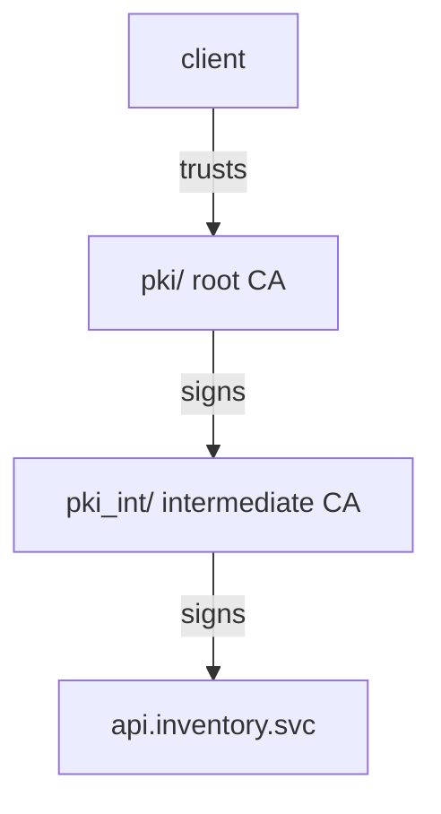

# The PKI Engine And A Root CA

A certificate chain starts at a root CA. Every client that should trust your services must hold the root CA certificate, so the root is the one thing that must stay the same for years. This part enables the PKI secrets engine and creates the root CA inside OpenBao, so its private key is never written to a file or copied to a laptop.

## Set up your terminal

The commands in this part need the port-forward running in a second terminal:

<!-- astrona:playground:renew -->

```sh
kubectl -n openbao port-forward svc/openbao 8200:8200
```

Then point `bao` at the server with the lab-only root token. A real installation revokes its root token after setup and uses tokens with policies instead:

```sh
export BAO_ADDR=http://openbao.localtest.me:8200
export BAO_TOKEN=$(kubectl -n openbao get secret openbao-init -o jsonpath='{.data.root-token}' | base64 -d)
```

## Enable the PKI engine for the root CA

The PKI secrets engine signs X.509 certificates: the standard format of TLS certificates, with a public key, a subject name, a lifetime and a signature. Each PKI mount holds one or more CAs. The usual layout keeps the root and the intermediate in separate mounts, so a policy can let applications use one mount without touching the other.

Enable the engine at the default path `pki/` and raise its maximum lease time. Every certificate a mount signs, including a CA certificate, has a lifetime, and OpenBao caps it at the mount's maximum lease time, which is 32 days by default. A root CA lives far longer:

```sh
bao secrets enable pki
bao secrets tune -max-lease-ttl=87600h pki
```

The first command enables the engine at `pki/`. The second sets the maximum to 87600 hours, that is ten years.

## Generate the root CA

A root CA is self-signed: its certificate is signed with its own key. OpenBao can generate it in two ways. With `internal`, OpenBao creates the private key and never returns it. With `exported`, OpenBao returns the private key once in the response. Use `internal` unless you have a reason to keep a copy of the key outside OpenBao.

Generate the root CA and keep its certificate in a file:

```sh
bao write -field=certificate pki/root/generate/internal \
    common_name="Inventory Root CA" ttl=87600h > root-ca.pem
```

The command prints nothing because `-field=certificate` sends only the certificate to the file `root-ca.pem`. The private key stays inside OpenBao. Read the certificate with `openssl`:

```sh
openssl x509 -in root-ca.pem -noout -subject -issuer -dates
```

The subject and the issuer are the same, `Inventory Root CA`: that is what self-signed means. The dates show a lifetime of about ten years.

## Issuers and the public CA endpoints

Inside a PKI mount, each CA is an issuer: one CA certificate together with its key. A mount can hold several issuers, for example an old and a new one during a rotation. List them, and fetch the CA certificate the way a client would:

```sh
bao list pki/issuers
curl -s $BAO_ADDR/v1/pki/ca/pem
```

`bao list pki/issuers` prints one issuer ID. The `curl` request sends no token at all and still returns the CA certificate in PEM format, the text form that starts with `BEGIN CERTIFICATE`. The PKI engine serves CA certificates and revocation lists without a token on purpose: clients must be able to fetch them to check a certificate.



The diagram shows the chain this module builds: the client trusts only the root CA, the root signs the intermediate, and the intermediate signs the service certificates.

You now have a root CA whose key never left OpenBao, and you know where clients fetch its certificate. You could issue service certificates from it right away, but that would put the root key to work every day. The open question is how to keep the root out of daily use, which is the job of an intermediate CA.

## Common pitfalls

> [!WARNING]
> - **Forgetting to tune the mount.** Without `bao secrets tune -max-lease-ttl`, the CA certificate is capped at the mount default of 32 days, and the whole chain expires a month later.
> - **Generating the root with `exported` and not storing the key safely.** The response is the only time OpenBao returns that key. With `internal`, there is nothing to lose.
> - **Expecting the CA endpoints to need a token.** `/v1/pki/ca/pem` answers anyone. Never put anything secret in a CA certificate's names.
> - **Reading `-field=certificate` on a terminal and copying it by hand.** Write it straight to a file, so no line breaks get lost.
