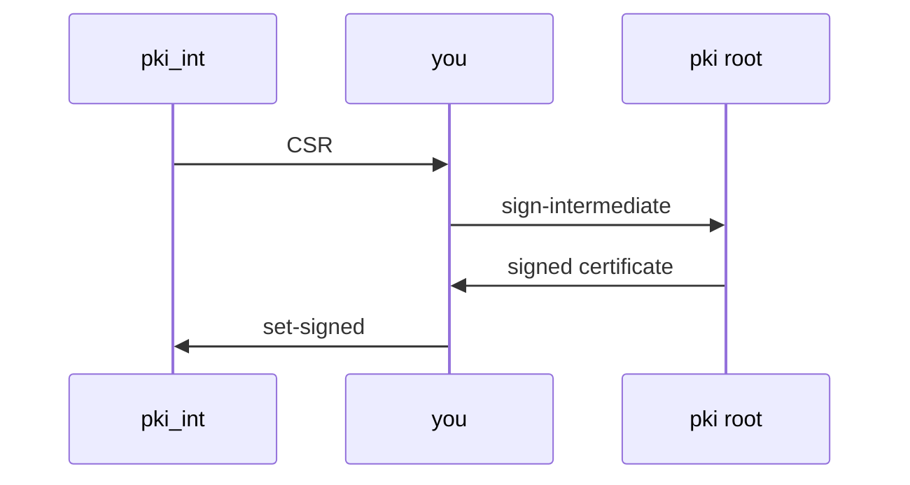

# An Intermediate CA Signed By The Root

A root CA that signs service certificates every day is a root CA whose key is used every day. If that key ever leaks, every client in the company must replace the root it trusts. The usual answer is an intermediate CA: a second CA that the root signs once, and that does the daily work. If the intermediate leaks, the root revokes it and signs a new one, and clients change nothing.

## Set up your terminal and the root CA

The commands in this part need the port-forward running in a second terminal, and the root CA "Inventory Root CA" in the mount `pki/`.

<!-- astrona:playground:renew -->

Start the port-forward in a second terminal and leave it running:

```sh
kubectl -n openbao port-forward svc/openbao 8200:8200
```

Point `bao` at the server with the lab-only root token, and save the root CA certificate to a file. If the second command fails because `pki/` does not exist, create the root first with `bao secrets enable pki`, `bao secrets tune -max-lease-ttl=87600h pki` and `bao write pki/root/generate/internal common_name="Inventory Root CA" ttl=87600h`:

```sh
export BAO_ADDR=http://openbao.localtest.me:8200
export BAO_TOKEN=$(kubectl -n openbao get secret openbao-init -o jsonpath='{.data.root-token}' | base64 -d)
curl -s $BAO_ADDR/v1/pki/ca/pem > root-ca.pem
```

## Why the root signs only the intermediate

The two CAs have different jobs, so they get different lifetimes and different mounts. A policy can then allow applications to use `pki_int/` and nobody but administrators to use `pki/`.

| | Root CA (`pki/`) | Intermediate CA (`pki_int/`) |
| --- | --- | --- |
| Signs | Intermediate CAs only | Service certificates |
| Lifetime in this module | 10 years | 5 years |
| Used | Once per intermediate | On every certificate request |
| If its key leaks | Every client must replace the root it trusts | The root revokes it and signs a new one |

## Create the intermediate and its CSR

An intermediate CA starts as a key and a certificate signing request (CSR). A CSR is a request that holds a public key and the name it should get; a CA reads it and returns a signed certificate. Enable a second PKI mount, raise its maximum lease time, and generate the key and the CSR inside OpenBao:

```sh
bao secrets enable -path=pki_int pki
bao secrets tune -max-lease-ttl=43800h pki_int
bao write -field=csr pki_int/intermediate/generate/internal \
    common_name="Inventory Intermediate CA" ttl=43800h > pki_int.csr
```

With `internal`, the private key of the intermediate stays inside OpenBao, just like the root key. Only the CSR leaves, in the file `pki_int.csr`. Check what it asks for:

```sh
openssl req -in pki_int.csr -noout -subject
```

The subject is `Inventory Intermediate CA`. At this point the mount `pki_int/` has a key but no certificate, so it cannot sign anything yet.

## Sign the CSR with the root and install the certificate

The root CA signs the CSR. The format `pem_bundle` returns the new certificate followed by the root certificate, which is the chain the intermediate needs. Then the intermediate mount gets its signed certificate:

```sh
bao write -field=certificate pki/root/sign-intermediate \
    csr=@pki_int.csr format=pem_bundle ttl=43800h > intermediate.cert.pem
bao write pki_int/intermediate/set-signed certificate=@intermediate.cert.pem
```

The `@` in `csr=@pki_int.csr` tells `bao` to read the value from the file on your machine. The second command stores the signed certificate in `pki_int/` as its issuer. From now on, that mount can sign certificates.



The diagram shows the CSR flow: the intermediate mount creates the CSR, the root mount signs it, and the signed certificate goes back into the intermediate mount.

## Check the chain

A client trusts the intermediate only if it chains up to the root it already trusts. Fetch the intermediate certificate the way a client would, without a token, and check it against the root with `openssl verify`:

```sh
curl -s $BAO_ADDR/v1/pki_int/ca/pem > intermediate-ca.pem
openssl x509 -in intermediate-ca.pem -noout -subject -issuer
openssl verify -CAfile root-ca.pem intermediate-ca.pem
```

The subject is `Inventory Intermediate CA` and the issuer is `Inventory Root CA`. `openssl verify` ends its line with `OK`, which means the intermediate certificate carries a valid signature from the root.

You now have a two-tier hierarchy, and the root key has done its only job. The intermediate can sign certificates, but nothing limits what it signs yet: any request could ask for any name. The open question is how to restrict names and lifetimes, which is the job of a role.

## Common pitfalls

> [!WARNING]
> - **Forgetting `set-signed`.** After `generate/internal`, the intermediate mount has a key but no certificate. Every issue request fails until the signed certificate is installed.
> - **Losing the CSR.** The CSR is printed once. If it is lost before signing, generate a new one; the old key is then never used.
> - **Giving the intermediate a longer lifetime than the root.** A certificate cannot be valid after its issuer expires. Keep the intermediate shorter than the root.
> - **Signing with the wrong mount.** `sign-intermediate` must be called on the root mount (`pki/root/sign-intermediate`), not on `pki_int/`.
