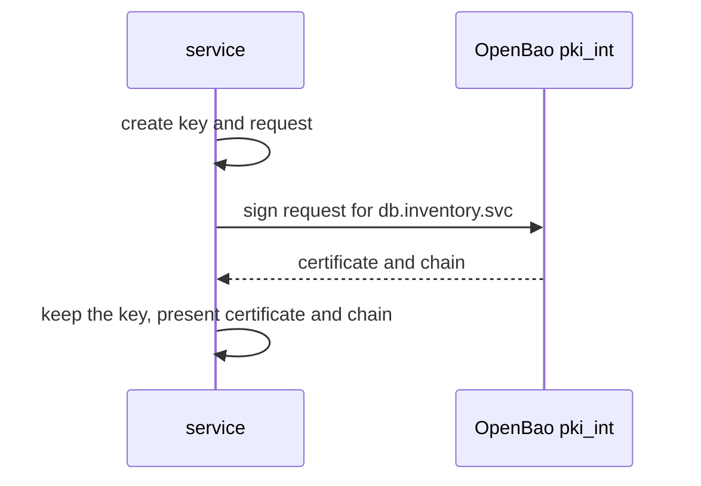

# Signing Requests And Inspecting Certificates

Until now OpenBao created the private key together with the certificate. Many systems prefer to keep their private key to themselves and send only a certificate signing request. This part signs a request, compares it with issuing, and reads what a certificate contains and what OpenBao keeps about it.

## Set up your terminal

The commands in this part need the two-tier CA from this module: the mount `pki/` with the root and `pki_int/` with the signed intermediate and the role `inventory-svc`.

<!-- astrona:playground:renew -->

Start the port-forward in a second terminal and leave it running:

```sh
kubectl -n openbao port-forward svc/openbao 8200:8200
```

Point `bao` at the server with the lab-only root token:

```sh
export BAO_ADDR=http://openbao.localtest.me:8200
export BAO_TOKEN=$(kubectl -n openbao get secret openbao-init -o jsonpath='{.data.root-token}' | base64 -d)
```

```sh
curl -s $BAO_ADDR/v1/pki/ca/pem > root-ca.pem
curl -s $BAO_ADDR/v1/pki_int/ca/pem > intermediate-ca.pem
```

If the mounts and the role do not exist, build them as in the earlier parts first.

## Issue or sign

| Endpoint | Who creates the private key | Typical use |
| --- | --- | --- |
| `pki_int/issue/<role>` | OpenBao, and it returns the key once | Automation that can receive a key |
| `pki_int/sign/<role>` | The requester, and the key never reaches OpenBao | Servers, devices and tools that make their own key |

Both obey the role: the same name, TTL and key limits apply.

## Sign a request

Create a key and a request with `openssl`, then let the role sign it:

```sh
openssl req -new -newkey rsa:2048 -nodes -keyout db.key -out db.csr -subj "/CN=db.inventory.svc"
bao write -field=certificate pki_int/sign/inventory-svc csr=@db.csr common_name=db.inventory.svc ttl=1h > db.pem
openssl verify -CAfile root-ca.pem -untrusted intermediate-ca.pem db.pem
```

The key `db.key` never leaves your machine. `openssl verify` ends with `OK`. The name in the request is checked against the role: a `common_name` that the role does not allow is refused, even though the request itself is valid.

## Read what a certificate contains

```sh
openssl x509 -in db.pem -noout -subject -issuer -serial -dates
openssl x509 -in db.pem -noout -ext subjectAltName,extendedKeyUsage
```

The first command shows the subject, the issuer, the serial number and the validity period. The second shows the names the certificate is valid for and the purposes it may be used for. A role controls the purposes with `server_flag` and `client_flag`, which are both true by default, and with `ext_key_usage`:

```sh
bao read pki_int/roles/inventory-svc
```

A certificate for a web server needs the server purpose; a certificate that a client shows to a server needs the client purpose. A mismatch causes handshake errors that look like trust problems.

## Read what OpenBao keeps

By default OpenBao stores every certificate it issues. List the serial numbers and read one:

```sh
bao list pki_int/certs
SERIAL=$(openssl x509 -in db.pem -noout -serial | cut -d= -f2)
bao read pki_int/cert/$SERIAL
```

The read returns the certificate and, for a revoked one, the revocation time. A role with `no_store=true` does not keep certificates, so they cannot be listed or read this way; that reduces the load of a mount that issues very many short-lived certificates, but the certificates cannot be revoked by serial number either.

## The chain

The response of `issue` and `sign` contains the issuing CA and the chain. A server should present its certificate followed by the intermediates, not the root:

```sh
bao write -format=json pki_int/issue/inventory-svc common_name=api.inventory.svc ttl=1h | jq -r '.data.ca_chain[]' | head -3
```



The diagram shows that with signing the private key stays with the service.

You can now sign requests and read certificates. That completes the PKI basics of this module.

## Common pitfalls

> [!WARNING]
> - **Using `issue` for devices that make their own key.** Use `sign`, so OpenBao never sees the key.
> - **Presenting the root CA in the chain.** Clients already trust it; send the certificate and the intermediates.
> - **Setting `no_store=true` without a plan for revocation.** Such certificates cannot be revoked by serial number.
> - **Ignoring `server_flag` and `client_flag`.** The purposes in the certificate must match how it is used.
