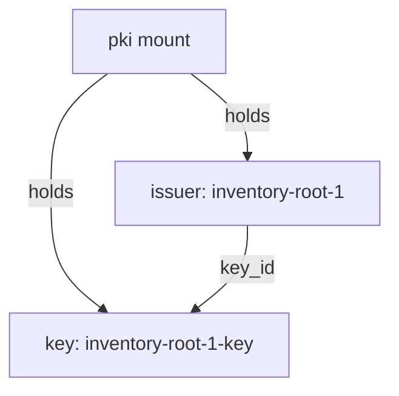

# Issuers And Keys

Older PKI mounts held exactly one CA. A mount now stores issuers and keys as separate objects, and each has an ID and an optional name. This part generates a root, reads the issuer and the key it created, and shows how the two relate.

## Set up your terminal

The commands in this part need a PKI mount at `pki/`.

<!-- astrona:playground:renew -->

Start the port-forward in a second terminal and leave it running:

```sh
kubectl -n openbao port-forward svc/openbao 8200:8200
```

Point `bao` at the server with the lab-only root token:

```sh
export BAO_ADDR=http://openbao.localtest.me:8200
export BAO_TOKEN=$(kubectl -n openbao get secret openbao-init -o jsonpath='{.data.root-token}' | base64 -d)
```

```sh
bao secrets enable pki
bao secrets tune -max-lease-ttl=87600h pki
```

If the mount already exists, ignore the error from the first line.

## Generate a root with names

An issuer is a CA certificate stored in the mount together with a reference to its key. A key is the private key of a CA. The key never leaves the mount when you use the `internal` type. Give both a name, so you do not have to work with IDs:

```sh
bao write pki/root/generate/internal \
    common_name="Inventory Root CA" \
    issuer_name=inventory-root-1 \
    key_name=inventory-root-1-key \
    ttl=87600h
```

The response has the certificate, `issuer_id` and `key_id`. It has no private key, because `internal` keeps it inside OpenBao. The `exported` type would return the key once, and should only be used when you must copy the root to another system.

## List and read issuers

Issuers and keys have their own list paths:

```sh
bao list pki/issuers
bao list pki/keys
bao read pki/issuer/inventory-root-1
bao read pki/key/inventory-root-1-key
```

A reference to an issuer or a key can be its ID, its name, or the word `default`. The issuer read shows `issuer_id`, `issuer_name`, `key_id`, `certificate`, `ca_chain`, `usage` and the URLs that the issuer puts into certificates. The key read shows `key_id`, `key_name` and `key_type`, but never the private key.

One key can belong to several issuers. A new certificate for the same key, for example with a longer lifetime, is a second issuer with the same `key_id`. The two issuers sign with the same key, and clients that trust either certificate trust both.

## Rename an issuer

Names are changed by writing to the issuer:

```sh
bao write pki/issuer/inventory-root-1 issuer_name=inventory-root-first
bao read -field=issuer_name pki/issuer/inventory-root-first
```

A name must be unique in the mount and cannot be `default`. Later steps use the first name, so rename it back:

```sh
bao write pki/issuer/inventory-root-first issuer_name=inventory-root-1
```



The diagram shows that the mount stores issuers and keys separately and that an issuer points to its key by `key_id`.

You can now create an issuer, find it by name and read its key reference. With one issuer there is nothing to choose, so the next part adds a second issuer and decides which one signs.

## Common pitfalls

> [!WARNING]
> - **Generating an exported root without need.** The private key then appears in the response and in your terminal history.
> - **Using IDs in scripts.** Names stay the same across mounts and are readable. Set `issuer_name` at creation.
> - **Assuming a rename changes certificates.** The name is a label inside OpenBao. Issued certificates do not carry it.
