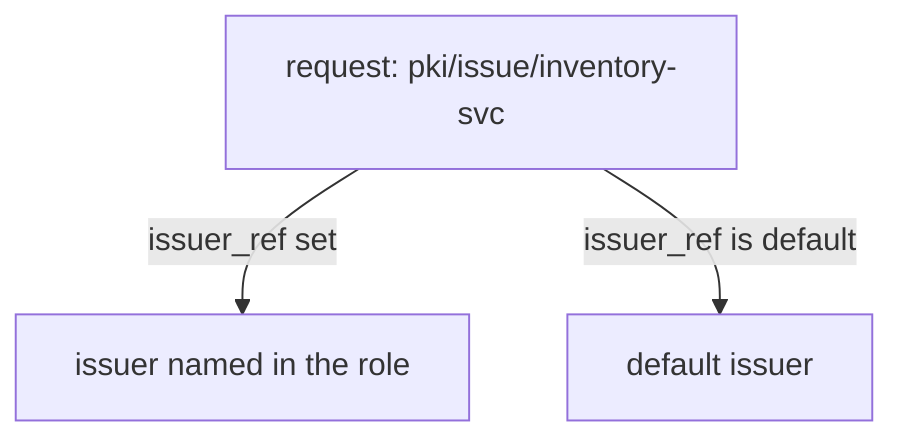

# The Default Issuer And Roles

When a mount has more than one issuer, a request for a certificate must be answered by exactly one of them. The default issuer answers unless a role says otherwise. This part adds a second issuer, changes the default, and pins a role to a specific issuer.

## Set up your terminal

The commands in this part need the mount `pki/` with the issuer `inventory-root-1`.

<!-- astrona:playground:renew -->

Start the port-forward in a second terminal and leave it running:

```sh
kubectl -n openbao port-forward svc/openbao 8200:8200
```

Point `bao` at the server with the lab-only root token:

```sh
export BAO_ADDR=http://openbao.localtest.me:8200
export BAO_TOKEN=$(kubectl -n openbao get secret openbao-init -o jsonpath='{.data.root-token}' | base64 -d)
```

```sh
bao secrets enable pki
bao secrets tune -max-lease-ttl=87600h pki
bao write pki/root/generate/internal common_name="Inventory Root CA" issuer_name=inventory-root-1 ttl=87600h
```

If the mount exists, ignore the errors from the first lines. If the root already exists, the last line adds a second root with the same name and fails; ignore that error too.

## Add a second issuer

Generate a second root in the same mount. Nothing about the first one changes:

```sh
bao write pki/root/generate/internal common_name="Inventory Root CA 2" issuer_name=inventory-root-2 ttl=87600h
bao list pki/issuers
bao read pki/config/issuers
```

The configuration shows `default`, which holds the ID of the default issuer, and `default_follows_latest_issuer`, which is `false`. The default is still `inventory-root-1`. The new issuer was added, not made the default.

## Change the default

The default is changed with `pki/config/issuers`:

```sh
bao write pki/config/issuers default=inventory-root-2
bao read -field=default pki/config/issuers
```

The command prints the ID of the new default. From now on, every request that does not name an issuer is signed by `inventory-root-2`. Certificates already issued by the first root stay valid, because the first issuer still exists and its certificate has not changed.

With `default_follows_latest_issuer=true`, a newly imported or generated issuer becomes the default at once. Leave it `false` when you want to test a new issuer before it signs production certificates.

## Pin a role to an issuer

A role can fix the issuer with `issuer_ref`. This is how you move one application to the new issuer while the others stay on the old one:

```sh
bao write pki/roles/inventory-svc allowed_domains=inventory.svc allow_subdomains=true max_ttl=72h issuer_ref=inventory-root-1
bao write -format=json pki/issue/inventory-svc common_name=api.inventory.svc | jq -r '.data.issuing_ca' | openssl x509 -noout -subject
```

The subject of the issuing CA is `CN=Inventory Root CA`: the role chose the first issuer, although the default is the second. Change the role to `issuer_ref=default` and the same command shows `CN=Inventory Root CA 2`.

A mount that serves clients that trust only the old root cannot move them all at once. Pinning roles lets each application switch after its trust store contains the new root.



The diagram shows that the role decides which issuer signs, and that the default is only a fallback.

You can now run two issuers side by side and decide which signs which certificates. The next part uses this to rotate a root.

## Common pitfalls

> [!WARNING]
> - **Changing the default before clients trust the new root.** New certificates then fail verification.
> - **Forgetting that roles keep `issuer_ref`.** A role pinned to an old issuer keeps using it after you change the default.
> - **Deleting the old issuer to switch.** Changing the default is enough. Deleting breaks the validation of the certificates it issued.
