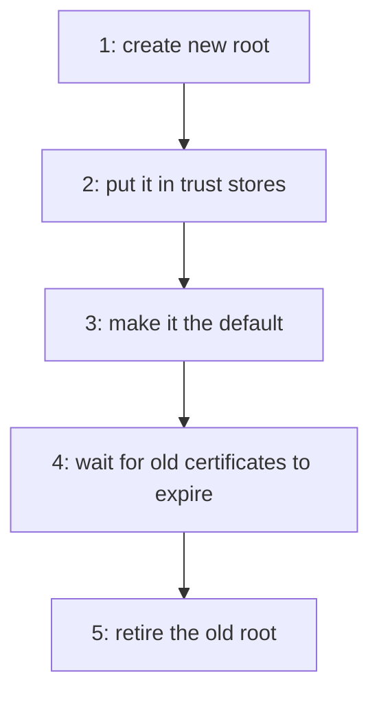

# Rotating A Root CA

A rotation replaces the CA that signs new certificates without invalidating old ones. The order matters: the new root must be trusted by every client before it signs anything they see. This part runs the rotation inside OpenBao and lists what the operator must do outside it.

## Set up your terminal

The commands in this part need the mount `pki/` with the issuer `inventory-root-1` as default and a role `inventory-svc`.

<!-- astrona:playground:renew -->

Start the port-forward in a second terminal and leave it running:

```sh
kubectl -n openbao port-forward svc/openbao 8200:8200
```

Point `bao` at the server with the lab-only root token:

```sh
export BAO_ADDR=http://openbao.localtest.me:8200
export BAO_TOKEN=$(kubectl -n openbao get secret openbao-init -o jsonpath='{.data.root-token}' | base64 -d)
```

```sh
bao secrets enable pki
bao secrets tune -max-lease-ttl=87600h pki
bao write pki/root/generate/internal common_name="Inventory Root CA" issuer_name=inventory-root-1 ttl=87600h
bao write pki/roles/inventory-svc allowed_domains=inventory.svc allow_subdomains=true max_ttl=72h
```

If the mount and the root exist, the first lines fail and you can ignore the errors.

## Create the new root

`pki/root/rotate/internal` generates a new root in the same mount. It takes the same fields as `root/generate`. It is meant for a mount that already has a root, and it keeps the old issuer in place:

```sh
bao write pki/root/rotate/internal \
    common_name="Inventory Root CA 2" \
    issuer_name=inventory-root-2 \
    key_name=inventory-root-2-key \
    ttl=87600h
bao list pki/issuers
```

Two issuers exist. The default has not changed unless the mount has `default_follows_latest_issuer` set to `true`. Use a new key, as here. Reusing the old key is possible, but it defeats the purpose when the old key might have been exposed.

## Distribute the new root

The operator now gives the new root certificate to every client and server that verifies certificates. `pki/issuer/<ref>/pem` and `pki/ca/pem` return a CA certificate without a token:

```sh
curl -s http://openbao.localtest.me:8200/v1/pki/issuer/inventory-root-2/pem > inventory-root-2.pem
openssl x509 -in inventory-root-2.pem -noout -subject -dates
```

The subject is `CN=Inventory Root CA 2`. Add the file to every trust store before the next step. For a rotation without downtime, wait until all clients have it.

## Switch signing to the new root

When the clients trust the new root, make it the default and check a certificate:

```sh
bao write pki/config/issuers default=inventory-root-2
bao write -format=json pki/issue/inventory-svc common_name=api.inventory.svc \
    | jq -r '.data.issuing_ca' | openssl x509 -noout -subject
```

The issuing CA is now `CN=Inventory Root CA 2`. Certificates that the first root issued earlier still validate against the first root, which clients still trust, until they expire or are revoked.

## Cross-signing for clients that cannot update

Some clients cannot get a new root quickly. For them, the old root can sign the new root's certificate. A client that trusts the old root then validates a chain through a certificate for the new key. OpenBao supports this with `pki/intermediate/cross-sign` (to create the request from the new key) and `pki/issuer/<old>/sign-intermediate` (to sign it), and the signed result is imported with `pki/intermediate/set-signed`. It is an advanced step, and the lab does not need it.



The diagram shows the order of a rotation, and that retiring the old root is the last step.

You can now rotate a root inside OpenBao and name the steps outside it. The old root still exists, and the last part limits it and removes it when it is no longer needed.

## Common pitfalls

> [!WARNING]
> - **Switching the default before the clients trust the new root.** Verification fails everywhere.
> - **Reusing the old key for the new root when the key may be exposed.** The rotation protects nothing then.
> - **Forgetting intermediates.** An intermediate signed by the old root keeps working only while the old root is trusted.

## Your mission: Rotate The Root Issuer Of A PKI Mount

You can now add a root, make it the default and keep the old issuer for existing certificates. The graded lab gives you a PKI mount with one old root and asks you to rotate it, switch signing to the new root and stop the old root from signing, without deleting it.

The lab runs in its own cluster, so first pause your playground. Nothing in it is lost:

```sh
astrona stop ats-114-playground-020-02
```

Then start the lab:

```sh
astrona run --git ssh://git@github.com/astrona-io/ATS114.git -c sections/section-020/module-02/labs/lab-01
```

The task is on the next page. Solve it on your own first. When you think you are done, send it for grading:

```sh
astrona submit -c sections/section-020/module-02/labs/lab-01
```

When the lab is done, remove it and start your playground again:

```sh
astrona destroy ats-114-lab-020-02
astrona start ats-114-playground-020-02
```
