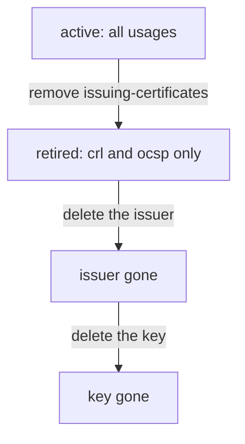

# Retiring An Issuer

After a rotation, the old issuer has no reason to sign new certificates, but it must still sign revocation lists and its certificate must stay available for validation. This part limits the old issuer with its `usage` field and shows when deleting is correct.

## Set up your terminal

The commands in this part need the mount `pki/` with two issuers, `inventory-root-1` and `inventory-root-2`.

<!-- astrona:playground:renew -->

Start the port-forward in a second terminal and leave it running:

```sh
kubectl -n openbao port-forward svc/openbao 8200:8200
```

Point `bao` at the server with the lab-only root token:

```sh
export BAO_ADDR=http://openbao.localtest.me:8200
export BAO_TOKEN=$(kubectl -n openbao get secret openbao-init -o jsonpath='{.data.root-token}' | base64 -d)
```

```sh
bao secrets enable pki
bao secrets tune -max-lease-ttl=87600h pki
bao write pki/root/generate/internal common_name="Inventory Root CA" issuer_name=inventory-root-1 ttl=87600h
bao write pki/root/rotate/internal common_name="Inventory Root CA 2" issuer_name=inventory-root-2 ttl=87600h
```

If the mount and the issuers exist, the errors can be ignored.

## Read the usage of an issuer

Every issuer has a `usage` field, a comma-separated list of what it may do:

```sh
bao read -field=usage pki/issuer/inventory-root-1
```

The values are `issuing-certificates` (sign leaf and intermediate certificates), `crl-signing` (sign certificate revocation lists), `ocsp-signing` (sign Online Certificate Status Protocol responses) and `read-only`, which is always implied. A new issuer has all of them.

## Stop the old issuer from signing certificates

Remove `issuing-certificates` and keep the other usages:

```sh
bao write pki/issuer/inventory-root-1 usage=crl-signing,ocsp-signing
bao read -field=usage pki/issuer/inventory-root-1
```

The old issuer can no longer sign new certificates. A role pinned to it now fails to issue, which shows you a role you forgot to move. The old issuer still signs the revocation list and OCSP responses, so revoked certificates stay revoked, and clients can still fetch its certificate.

Test it by pinning a role to the old issuer and requesting a certificate. The request fails with an error:

```sh
bao write pki/roles/old-test allowed_domains=inventory.svc allow_subdomains=true issuer_ref=inventory-root-1
bao write pki/issue/old-test common_name=api.inventory.svc
```

## Delete an issuer and its key

Delete only when no certificate that the issuer signed is still valid, and no client needs its certificate or CRL. Delete the issuer first, then its key:

```sh
bao delete pki/issuer/inventory-root-1
bao delete pki/key/inventory-root-1-key
```

If the deleted issuer was the default, OpenBao has no default until you set one. Check with `bao read pki/config/issuers`.



The diagram shows the stages from an active issuer to a deleted one. Each stage removes one ability.

You can now retire an issuer in steps. Together with creating and choosing issuers, this is the complete life of a CA in a PKI mount.

## Common pitfalls

> [!WARNING]
> - **Deleting the old issuer while certificates it signed are in use.** They can no longer be verified through the mount or revoked.
> - **Removing `crl-signing` too early.** The old issuer then stops publishing its revocation list, and revoked certificates may look valid again.
> - **Leaving a role pinned to a retired issuer.** Its requests fail after the change.
