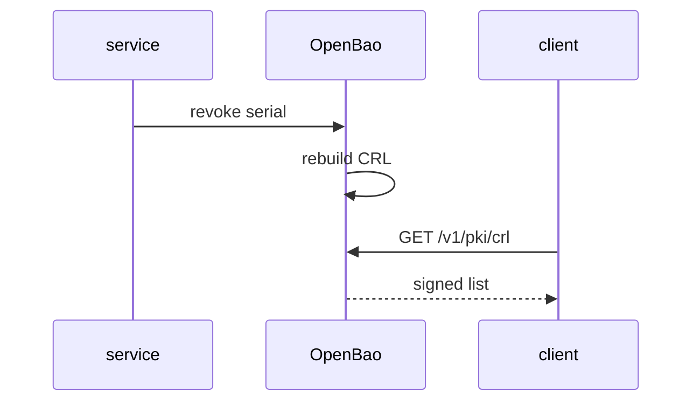

# Revoking Certificates And Reading The CRL

A certificate is valid until it expires, unless the CA revokes it. Revocation is how a CA says "do not trust this certificate any more" before its end date. This part issues two certificates, revokes one by its serial number, and reads the list that clients use to learn about it.

## Set up your terminal

The commands in this part need a PKI mount `pki/` with a root CA and a role `inventory-svc`.

<!-- astrona:playground:renew -->

Start the port-forward in a second terminal and leave it running:

```sh
kubectl -n openbao port-forward svc/openbao 8200:8200
```

Point `bao` at the server with the lab-only root token:

```sh
export BAO_ADDR=http://openbao.localtest.me:8200
export BAO_TOKEN=$(kubectl -n openbao get secret openbao-init -o jsonpath='{.data.root-token}' | base64 -d)
```

```sh
bao secrets enable pki
bao secrets tune -max-lease-ttl=87600h pki
bao write pki/root/generate/internal common_name="Inventory Root CA" ttl=87600h
bao write pki/roles/inventory-svc allowed_domains=inventory.svc allow_subdomains=true max_ttl=72h
```

If the mount and the root exist, ignore the errors.

## Issue two certificates

The issue response contains the certificate, the private key and `serial_number`, the identifier of the certificate inside the CA. Keep the serial numbers:

```sh
SERIAL_A=$(bao write -format=json pki/issue/inventory-svc common_name=a.inventory.svc | jq -r '.data.serial_number')
SERIAL_B=$(bao write -format=json pki/issue/inventory-svc common_name=b.inventory.svc | jq -r '.data.serial_number')
echo "$SERIAL_A"
```

A serial number is hexadecimal, with a colon between every two characters. OpenBao accepts the colon form and the hyphen form.

## Revoke a certificate

Revoking needs only the serial number. The response contains the revocation time:

```sh
bao write pki/revoke serial_number="$SERIAL_A"
```

The CA also revokes by key: `pki/revoke-with-key` takes the certificate and its private key, so the holder can revoke a certificate without a token that has access to `pki/revoke`. Use it when a service finds its own key exposed.

Read both certificates. A revoked certificate has a non-zero `revocation_time`:

```sh
bao read -field=revocation_time pki/cert/"$(printf '%s' "$SERIAL_A" | tr ':' '-')"
bao read -field=revocation_time pki/cert/"$(printf '%s' "$SERIAL_B" | tr ':' '-')"
```

The first command prints a Unix time, and the second prints `0`. The CA stores issued certificates by default, which is what makes this lookup work. A role with `no_store=true` does not store certificates, and then they cannot be listed or looked up, and revoking needs the key.

## The CRL

The certificate revocation list is a signed document that lists revoked serial numbers. Clients fetch it from the address inside the certificate. OpenBao serves it without a token:

```sh
curl -s http://openbao.localtest.me:8200/v1/pki/crl/pem | openssl crl -noout -text
```

The output lists the issuer, `Last Update`, `Next Update` and the revoked serial number. The `Next Update` time is when clients must fetch a new list. OpenBao rebuilds the list when a certificate is revoked, and a manual rebuild is possible:

```sh
bao read pki/crl/rotate
```



The diagram shows that revoking changes the CRL inside OpenBao, and that clients learn about it only when they fetch the list.

You can now revoke a certificate and see it in the CRL. How long the list is valid, and when it is rebuilt, are settings, and the next part sets them.

## Common pitfalls

> [!WARNING]
> - **Expecting clients to notice at once.** A client that cached the CRL keeps trusting the certificate until the list's `Next Update`.
> - **Revoking the wrong serial.** A revocation cannot be undone.
> - **Using `no_store` and then trying to revoke by serial.** The CA does not know the certificate. Use `revoke-with-key`.
