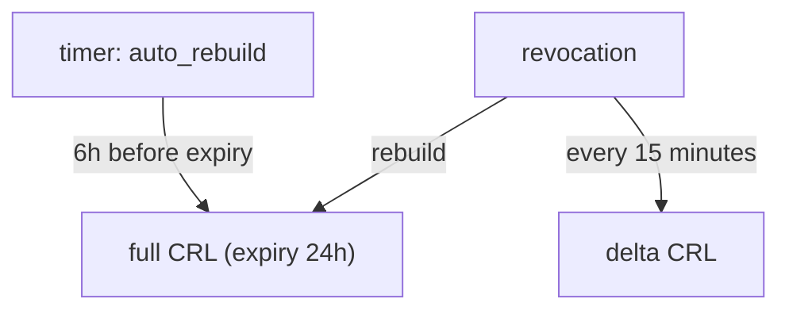

# Configuring The CRL

The default CRL is valid for 72 hours and is rebuilt when something is revoked. That is a reasonable start, but a CA that revokes often, or has many certificates, needs control over the lifetime and the rebuild schedule. This part reads and changes the CRL configuration.

## Set up your terminal

The commands in this part need the mount `pki/` with a root CA.

<!-- astrona:playground:renew -->

Start the port-forward in a second terminal and leave it running:

```sh
kubectl -n openbao port-forward svc/openbao 8200:8200
```

Point `bao` at the server with the lab-only root token:

```sh
export BAO_ADDR=http://openbao.localtest.me:8200
export BAO_TOKEN=$(kubectl -n openbao get secret openbao-init -o jsonpath='{.data.root-token}' | base64 -d)
```

```sh
bao secrets enable pki
bao secrets tune -max-lease-ttl=87600h pki
bao write pki/root/generate/internal common_name="Inventory Root CA" ttl=87600h
```

If the mount and the root exist, ignore the errors.

## Read the configuration

The CRL settings are in `pki/config/crl`:

```sh
bao read pki/config/crl
```

The important fields are `expiry`, the validity of a CRL (default `72h`); `disable`, which stops CRL building; `auto_rebuild`, which rebuilds the CRL on a timer even when nothing changed; `auto_rebuild_grace_period`, how long before expiry the rebuild happens; `enable_delta` and `delta_rebuild_interval`, for delta CRLs; and `ocsp_disable` and `ocsp_expiry` for the OCSP responder.

## Choose a lifetime and rebuild

A short `expiry` makes clients fetch the list more often, which shortens the time a revoked certificate looks valid. With `auto_rebuild=true`, OpenBao builds a new list before the old one expires, so the `Next Update` time never passes:

```sh
bao write pki/config/crl expiry=24h auto_rebuild=true auto_rebuild_grace_period=6h
bao read pki/config/crl
```

The list is now valid for 24 hours and OpenBao rebuilds it six hours before the end. Without `auto_rebuild`, the list is rebuilt only when a certificate is revoked or `pki/crl/rotate` is called, so a mount that revokes nothing for a long time would publish an expired list.

## Delta CRLs

A full CRL grows with every revocation. A delta CRL lists only the revocations since the last full list, so clients download a small file often and a large file rarely. Enable it with the fields below:

```sh
bao write pki/config/crl enable_delta=true delta_rebuild_interval=15m expiry=24h auto_rebuild=true auto_rebuild_grace_period=6h
curl -s http://openbao.localtest.me:8200/v1/pki/crl/delta/pem | openssl crl -noout -lastupdate -nextupdate
```

Send every field you care about in the same command, and read the configuration back to confirm it. The delta CRL needs `auto_rebuild=true`. The delta URL must also be known to clients through the certificate extension, which the delta CRL setting does not add by itself; check what your clients support before you rely on it.



The diagram shows that a revocation and a timer both produce a new list, and that the delta list is rebuilt more often than the full list.

You can now control how long a CRL is valid and when it is rebuilt. Clients that check one certificate at a time do not need the whole list, and the next part adds that.

## Common pitfalls

> [!WARNING]
> - **Writing only the field you want to change.** A write to `pki/config/crl` sets the other fields to their defaults. Read first, then write all fields.
> - **Setting a long `expiry` for a CA that revokes often.** Clients keep an old list for the whole time.
> - **Disabling the CRL while certificates carry its address.** Clients then fail to fetch it and may refuse every certificate.
