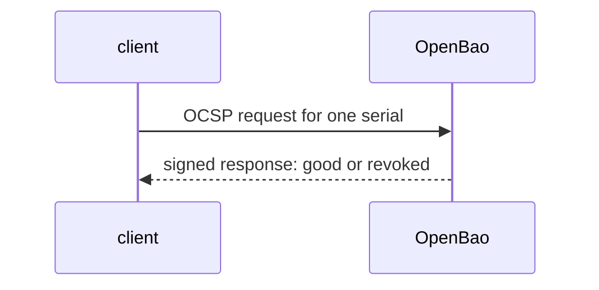

# OCSP And The URLs In A Certificate

A client does not have to download a full list. With the Online Certificate Status Protocol (OCSP), it asks the CA about one certificate and gets a short signed answer: good, revoked or unknown. For that, the certificate must carry the address of the responder. This part sets the addresses, asks the responder with `openssl`, and checks that a revoked certificate is reported as revoked.

## Set up your terminal

The commands in this part need the mount `pki/` with a root CA and the role `inventory-svc`.

<!-- astrona:playground:renew -->

Start the port-forward in a second terminal and leave it running:

```sh
kubectl -n openbao port-forward svc/openbao 8200:8200
```

Point `bao` at the server with the lab-only root token:

```sh
export BAO_ADDR=http://openbao.localtest.me:8200
export BAO_TOKEN=$(kubectl -n openbao get secret openbao-init -o jsonpath='{.data.root-token}' | base64 -d)
```

```sh
bao secrets enable pki
bao secrets tune -max-lease-ttl=87600h pki
bao write pki/root/generate/internal common_name="Inventory Root CA" ttl=87600h
bao write pki/roles/inventory-svc allowed_domains=inventory.svc allow_subdomains=true max_ttl=72h
```

If the mount and the root exist, ignore the errors. The port-forward from the set-up must run in a second terminal.

## Set the URLs

A certificate carries three addresses in its extensions: where to fetch the issuer certificate, where to fetch the CRL, and where to ask OCSP. The CA writes them from `pki/config/urls` at issue time:

```sh
bao write pki/config/urls \
    issuing_certificates="http://openbao.localtest.me:8200/v1/pki/ca" \
    crl_distribution_points="http://openbao.localtest.me:8200/v1/pki/crl" \
    ocsp_servers="http://openbao.localtest.me:8200/v1/pki/ocsp"
bao read pki/config/urls
```

The URLs apply to certificates issued **after** the change. Certificates that exist already do not change, so set the URLs before you issue.

The OCSP responder is on by default (`ocsp_disable` is `false` in `pki/config/crl`), and `ocsp_expiry` (default `12h`) sets how long a response may be cached.

## Ask the responder

Issue a certificate and save the files. The certificate and the CA certificate are in the response:

```sh
bao write -format=json pki/issue/inventory-svc common_name=a.inventory.svc > issued.json
jq -r '.data.certificate' issued.json > leaf.pem
jq -r '.data.issuing_ca' issued.json > ca.pem
openssl x509 -in leaf.pem -noout -ext authorityInfoAccess,crlDistributionPoints
```

The extension output shows the OCSP address and the CRL address from the configuration. Now ask the responder:

```sh
openssl ocsp -issuer ca.pem -cert leaf.pem -url http://openbao.localtest.me:8200/v1/pki/ocsp -CAfile ca.pem
```

The line for `leaf.pem` ends with `good`. Revoke the certificate and ask again:

```sh
bao write pki/revoke serial_number="$(jq -r '.data.serial_number' issued.json)"
openssl ocsp -issuer ca.pem -cert leaf.pem -url http://openbao.localtest.me:8200/v1/pki/ocsp -CAfile ca.pem
```

The answer now says `revoked`, with the revocation time. The client learned about the revocation at once, without downloading a list.



The diagram shows that the client sends one serial number and gets one signed answer.

You can now put the right addresses into certificates and check a certificate through both channels. The last operational task is to clean the storage.

## Common pitfalls

> [!WARNING]
> - **Changing the URLs and expecting old certificates to change.** Only new certificates carry the new addresses.
> - **Using an address clients cannot reach.** The certificate then points at a responder that nobody can contact. Use the name that the clients use.
> - **Treating `unknown` as `good`.** OCSP says `unknown` for a serial the CA does not know, for example a certificate issued with `no_store=true`.
