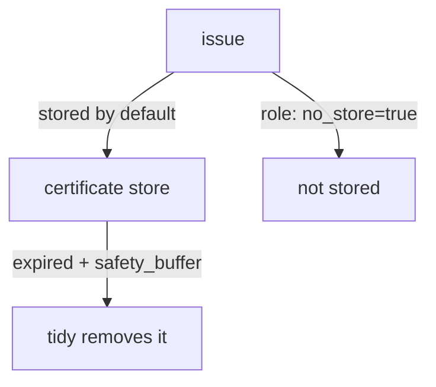

# Tidy And Auto-Tidy

By default the PKI engine stores every certificate it issues, and keeps them after they expire. A busy CA with short-lived certificates ends up with millions of entries, which slows down listing, backups and CRL builds. Tidy removes the entries that are no longer needed. This part runs a tidy by hand, reads its status, and schedules it.

## Set up your terminal

The commands in this part need the mount `pki/` with a root CA and the role `inventory-svc`.

<!-- astrona:playground:renew -->

Start the port-forward in a second terminal and leave it running:

```sh
kubectl -n openbao port-forward svc/openbao 8200:8200
```

Point `bao` at the server with the lab-only root token:

```sh
export BAO_ADDR=http://openbao.localtest.me:8200
export BAO_TOKEN=$(kubectl -n openbao get secret openbao-init -o jsonpath='{.data.root-token}' | base64 -d)
```

```sh
bao secrets enable pki
bao secrets tune -max-lease-ttl=87600h pki
bao write pki/root/generate/internal common_name="Inventory Root CA" ttl=87600h
bao write pki/roles/inventory-svc allowed_domains=inventory.svc allow_subdomains=true max_ttl=72h
```

If the mount and the root exist, ignore the errors.

## Run a tidy

`pki/tidy` starts a background job. You choose what to remove, and a safety buffer protects entries that expired only recently:

```sh
bao write pki/tidy tidy_cert_store=true tidy_revoked_certs=true safety_buffer=72h
```

`tidy_cert_store` removes expired certificates from the certificate store. `tidy_revoked_certs` removes expired revoked certificates from the CRL, so the list stops growing. `safety_buffer` is how long after expiry an entry must wait before tidy removes it; the default is 72 hours. The buffer gives clients time to see the last CRL that listed the certificate.

The response tells you that tidy was started in the background. Read the status:

```sh
bao read pki/tidy-status
```

The status shows `state` (`Running`, `Finished` or `Error`), the time it started and finished, and counters such as `cert_store_deleted_count` and `revoked_cert_deleted_count`. A running job can be stopped with `bao write pki/tidy-cancel`.

## Schedule it

Auto-tidy runs the same job on a timer. Without it, nobody remembers to run tidy:

```sh
bao write pki/config/auto-tidy enabled=true interval_duration=12h tidy_cert_store=true tidy_revoked_certs=true safety_buffer=72h
bao read pki/config/auto-tidy
```

The configuration shows the values you set. `interval_duration` is the time between runs. As with the CRL, send every option you need in the same command and read the configuration back.

## Reduce what is stored in the first place

Two role options cut the load before tidy runs. `no_store=true` stops the CA from storing certificates, which suits very short-lived certificates that you never revoke by serial; revocation then needs `revoke-with-key`, and OCSP answers `unknown`. `generate_lease=true` attaches a lease to each certificate so that revoking the lease revokes the certificate, which adds storage instead of saving it. Choose by what you need to be able to do later.



The diagram shows that certificates reach the store by default, that tidy removes them after expiry and the safety buffer, and that `no_store` keeps them out.

You can now keep a CA's storage under control. This completes the certificate lifecycle: issue, publish status, revoke and clean up.

## Common pitfalls

> [!WARNING]
> - **Setting `safety_buffer` too small.** Tidy may remove a revoked certificate before the CRL that lists it expires, and clients may then trust the certificate.
> - **Forgetting to repeat options in a config write.** Missing fields return to their defaults.
> - **Running tidy and expecting an instant result.** It is a background job; read `tidy-status`.

## Your mission: Configure CRL, OCSP And Tidy For A PKI Mount

You can now revoke certificates, build the CRL on a schedule and publish the right addresses. The graded lab gives you a mount with a compromised certificate and no maintenance settings, and asks you to revoke the certificate and set up the CRL, the OCSP address and automatic tidy.

The lab runs in its own cluster, so first pause your playground. Nothing in it is lost:

```sh
astrona stop ats-114-playground-020-03
```

Then start the lab:

```sh
astrona run --git ssh://git@github.com/astrona-io/ATS114.git -c sections/section-020/module-03/labs/lab-01
```

The task is on the next page. Solve it on your own first. When you think you are done, send it for grading:

```sh
astrona submit -c sections/section-020/module-03/labs/lab-01
```

When the lab is done, remove it and start your playground again:

```sh
astrona destroy ats-114-lab-020-03
astrona start ats-114-playground-020-03
```
