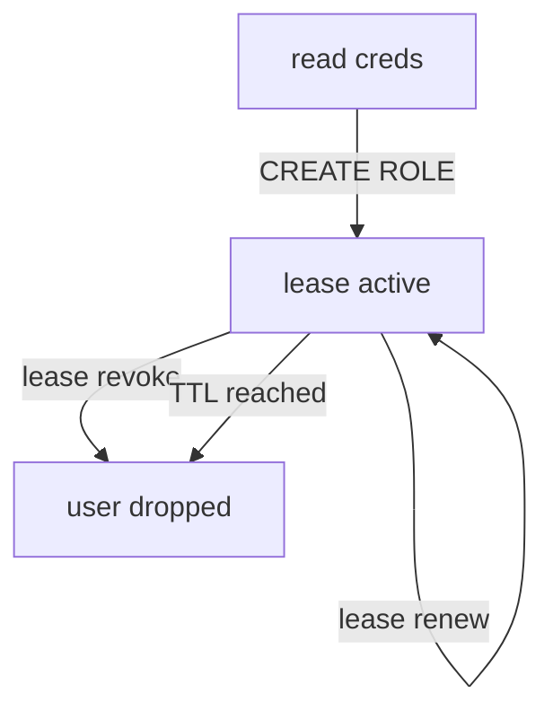

# Roles, Credentials And Their Leases

A connection lets OpenBao reach PostgreSQL, but it does not say what kind of user to create, with which rights, or for how long. That is the job of a role. This part writes a role that creates read-only users, reads a credential from it, uses that credential, and then follows its lease to the end.

## Set up your terminal

The commands in this part need the database secrets engine at `database/` with the connection `inventory-db` to PostgreSQL, connecting as `openbao_admin` and allowing the role `inventory-readonly`.

<!-- astrona:playground:renew -->

Start the port-forward in a second terminal and leave it running:

```sh
kubectl -n openbao port-forward svc/openbao 8200:8200
```

Then point `bao` at the server with the lab-only root token, and check that the connection exists:

```sh
export BAO_ADDR=http://openbao.localtest.me:8200
export BAO_TOKEN=$(kubectl -n openbao get secret openbao-init -o jsonpath='{.data.root-token}' | base64 -d)
bao read database/config/inventory-db
```

## Write the role

A database role holds the SQL that OpenBao runs to create a user, and the lifetime of that user. OpenBao fills in three placeholders: `{{name}}` (a generated user name), `{{password}}` (a generated password) and `{{expiration}}` (the time the lease ends). The `VALID UNTIL` clause makes PostgreSQL itself refuse the password after that time, as a second line of defence.

Save this as `inventory-readonly.sql`:

```sql
CREATE ROLE "{{name}}" WITH LOGIN PASSWORD '{{password}}' VALID UNTIL '{{expiration}}';
GRANT SELECT ON ALL TABLES IN SCHEMA public TO "{{name}}";
```

Write the role. The `@` tells `bao` to read the value from the file on your machine:

```sh
bao write database/roles/inventory-readonly \
    db_name=inventory-db \
    creation_statements=@inventory-readonly.sql \
    default_ttl=10m max_ttl=1h
```

`db_name` names the connection the role uses. `default_ttl` is the lease a new credential gets, here 10 minutes. `max_ttl` is the longest it can ever live, even with renewals, here 1 hour.

## Read a credential and use it

Reading from `database/creds/<role>` is the request that creates a user. Ask for one and keep the JSON response:

```sh
bao read -format=json database/creds/inventory-readonly > creds.json
jq -r '.lease_id, .lease_duration, .data.username' creds.json
```

The three lines show the lease ID (it starts with `database/creds/inventory-readonly/`), the lease duration in seconds (`600`), and the new user name, which starts with `v-`. Use the credential the way the application would, inside the PostgreSQL pod:

```sh
DB_USER=$(jq -r '.data.username' creds.json)
DB_PASSWORD=$(jq -r '.data.password' creds.json)
kubectl -n data exec -i deploy/postgres -- env PGPASSWORD="$DB_PASSWORD" \
    psql -h postgres.data -U "$DB_USER" -d inventory -c 'SELECT * FROM items'
```

The query returns the three rows of `items`. An `INSERT` with the same user fails with a permission error, because the role granted `SELECT` only.

## Follow the lease

The lease is how you manage the credential from now on. Look it up, renew it, and then revoke it:

```sh
LEASE_ID=$(jq -r '.lease_id' creds.json)
bao lease lookup "$LEASE_ID"
bao lease renew -increment=30m "$LEASE_ID"
bao lease revoke "$LEASE_ID"
```

`bao lease lookup` shows the time the lease expires and that it is renewable. `bao lease renew -increment=30m` asks for 30 minutes from now; the answer shows the duration OpenBao actually granted, which can never take the lease past the role's `max_ttl`. `bao lease revoke` ends the lease at once.

Revoking the lease made OpenBao drop the user in PostgreSQL. Check it as the database administrator:

```sh
kubectl -n data exec -i deploy/postgres -- env PGPASSWORD=postgres-admin-password \
    psql -h postgres.data -U postgres -d inventory -c '\du'
```

The user that started with `v-` is gone. A lease that is not renewed ends the same way, on its own, after 10 minutes.



The diagram shows the life of one credential: created by a read, kept alive by renewals up to `max_ttl`, and dropped by a revocation or when its time runs out.

You can now write a role, hand out short-lived users, and end them early. One credential has stayed the same the whole time, though: the password of `openbao_admin` that you typed into the connection. The open question is how to protect that one.

## Common pitfalls

> [!WARNING]
> - **Granting more than the application needs.** The creation statements are the only place the user's rights are set. A read-only role must grant only `SELECT`.
> - **Expecting renewals to last for ever.** A lease can be renewed only up to `max_ttl`; after that the application must read a new credential.
> - **Revoking with the user name.** `bao lease revoke` takes the lease ID, which the read response returns. Keep it with the credential.
> - **Forgetting `VALID UNTIL`.** Without it, a user that OpenBao fails to drop stays valid in PostgreSQL for ever.

## Your mission: Give The Inventory App Expiring Database Credentials

You can now connect OpenBao to PostgreSQL, write a role and prove that its users can read, cannot write and disappear when their lease is revoked. The graded lab gives you PostgreSQL and an OpenBao with no database engine, and asks you to build the connection and a read-only role with 10-minute leases, without ever giving OpenBao the superuser.

The lab runs in its own cluster, so first pause your playground. Nothing in it is lost:

```sh
astrona stop ats-114-playground-030-01
```

Then start the lab:

```sh
astrona run --git ssh://git@github.com/astrona-io/ATS114.git -c sections/section-030/module-01/labs/lab-01
```

The task is on the next page. Solve it on your own first. When you think you are done, send it for grading:

```sh
astrona submit -c sections/section-030/module-01/labs/lab-01
```

When the lab is done, remove it and start your playground again:

```sh
astrona destroy ats-114-lab-030-01
astrona start ats-114-playground-030-01
```
