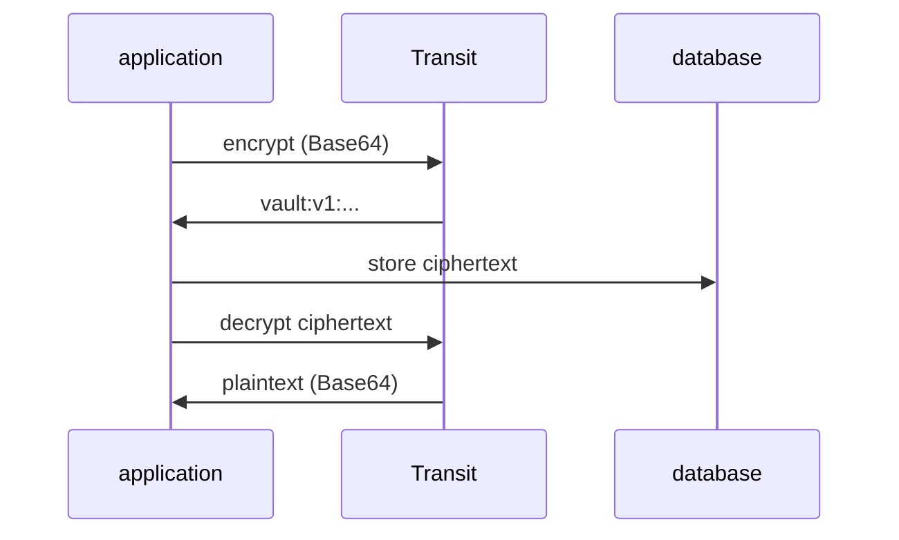

# Encryption As A Service

Most data leaks are not broken encryption; they are encryption keys found next to the data they protect. Transit removes the key from the application altogether. This part creates a Transit key, encrypts and decrypts a record, explains every piece of the ciphertext, and shows the one case where the application does the encryption itself: large data, with a data key.

## Set up your terminal

The commands in this part need the port-forward running in a second terminal.

<!-- astrona:playground:renew -->

Start it and leave it running:

```sh
kubectl -n openbao port-forward svc/openbao 8200:8200
```

Then point `bao` at the server with the lab-only root token. A real installation revokes its root token after setup:

```sh
export BAO_ADDR=http://openbao.localtest.me:8200
export BAO_TOKEN=$(kubectl -n openbao get secret openbao-init -o jsonpath='{.data.root-token}' | base64 -d)
```

## Create a key

Transit keys have a name and live only inside OpenBao. Enable the engine at its default path `transit/` and create the key `inventory-records`:

```sh
bao secrets enable transit
bao write -f transit/keys/inventory-records
bao read transit/keys/inventory-records
```

The `-f` flag sends the write without data, because the default settings are enough. The read shows the key's `type`, `aes256-gcm96` (AES with a 256-bit key in GCM mode, the default), `latest_version` `1`, `min_decryption_version` `1`, and a `keys` map with one entry per version. It never shows key material: by default a Transit key cannot be exported.

## Encrypt and decrypt

Transit accepts any bytes, including binary files, so the plaintext must be Base64-encoded in the request. Encrypt one order note:

```sh
bao write -field=ciphertext transit/encrypt/inventory-records \
    plaintext=$(printf '%s' 'order-1001: 40 bolts for dock 3' | base64)
```

The command prints one line, the ciphertext, such as `vault:v1:` followed by Base64 text. Each piece has a meaning:

| Piece | Meaning |
| --- | --- |
| `vault` | The ciphertext was made by Transit. OpenBao keeps this prefix from the Vault project it was forked from, so existing ciphertext stays readable |
| `v1` | The key version that encrypted it |
| The rest | The initialization vector and the encrypted data, Base64-encoded |

Transit stores none of this. The application keeps the ciphertext, for example in its database, and sends it back to decrypt. Save it in a variable and decrypt it; the plaintext comes back Base64-encoded, so decode it at the end:

```sh
CIPHERTEXT=$(bao write -field=ciphertext transit/encrypt/inventory-records \
    plaintext=$(printf '%s' 'order-1001: 40 bolts for dock 3' | base64))
bao write -field=plaintext transit/decrypt/inventory-records ciphertext="$CIPHERTEXT" | base64 -d
```

The last command prints `order-1001: 40 bolts for dock 3`. Encrypt the same text twice and compare: the two ciphertexts are different, because every encryption uses a new random initialization vector. Both decrypt to the same text.



The diagram shows the division of work: Transit holds the key and does the cryptography, the application's database holds only ciphertext.

## Data keys for large data

Sending a large file to OpenBao for every encryption is slow, and the HTTP API limits the request size (32 MB by default). For large data, Transit hands out a data key: a new random key, returned both in plaintext and encrypted with the Transit key.

```sh
bao write -f -format=json transit/datakey/plaintext/inventory-records | jq '.data | keys'
```

The response holds `plaintext` (the data key) and `ciphertext` (the same data key, encrypted with `inventory-records`). The application encrypts the large data locally with the plaintext data key, stores the encrypted data key next to it, and throws the plaintext data key away. To decrypt later, it asks Transit to decrypt the data key. The path `transit/datakey/wrapped/...` returns only the encrypted data key, for a system that will decrypt it later.

You can now encrypt and decrypt with a key the application never sees, read which version made a ciphertext, and handle large data with a data key. Every ciphertext so far says `v1`, though. The open question is what happens to all that stored data when the key changes.

## Common pitfalls

> [!WARNING]
> - **Sending plaintext that is not Base64.** Transit rejects it or decrypts to something else. Encode with `base64` before encrypting and decode after decrypting.
> - **Expecting Transit to store the data.** It stores keys only. Lose the ciphertext and the data is gone.
> - **Comparing ciphertexts to find equal values.** Every encryption uses a new initialization vector, so equal plaintexts give different ciphertexts.
> - **Exporting keys "for a backup".** Keys are not exportable by default, which is the point of Transit. Back up OpenBao itself instead.
