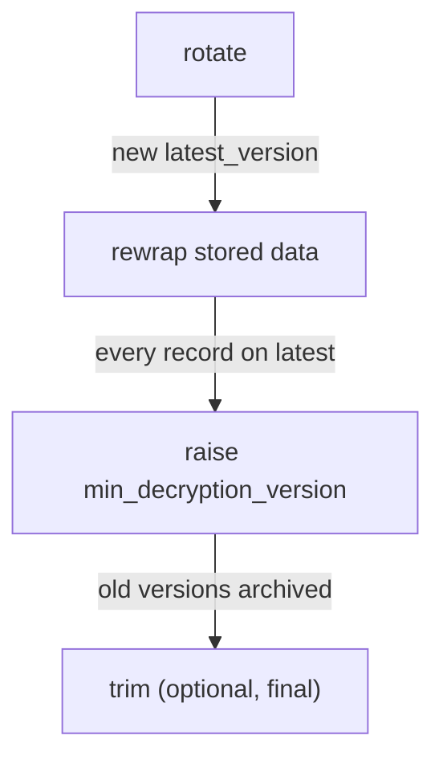

# Key Rotation, Rewrap And Retiring Old Versions

Security standards ask for encryption keys to be changed regularly, and a key that might have leaked must be changed at once. With a key in a configuration file, that means decrypting every record with the old key and encrypting it again with the new one, in the application. Transit splits the job into three safe steps: rotate the key, rewrap the stored ciphertext, and stop the old versions from decrypting.

## Set up your terminal and some old data

The commands in this part need the Transit engine at `transit/` with the key `inventory-records`.

<!-- astrona:playground:renew -->

Start the port-forward in a second terminal and leave it running:

```sh
kubectl -n openbao port-forward svc/openbao 8200:8200
```

Point `bao` at the server with the lab-only root token. If the engine or the key already exist, ignore the errors from the first two lines:

```sh
export BAO_ADDR=http://openbao.localtest.me:8200
export BAO_TOKEN=$(kubectl -n openbao get secret openbao-init -o jsonpath='{.data.root-token}' | base64 -d)
bao secrets enable transit
bao write -f transit/keys/inventory-records
```

Encrypt one record now, so you have ciphertext from the current version to work with:

```sh
OLD_CIPHERTEXT=$(bao write -field=ciphertext transit/encrypt/inventory-records \
    plaintext=$(printf '%s' 'order-1002: 12 washers for dock 1' | base64))
echo "$OLD_CIPHERTEXT"
```

## Rotate the key

A rotation adds a new key version to the key ring of `inventory-records`. New encryptions use the newest version; the older versions stay in the ring so old ciphertext can still be decrypted.

```sh
bao write -f transit/keys/inventory-records/rotate
bao read transit/keys/inventory-records
```

`latest_version` goes up by one, and the `keys` map has one more entry. `min_decryption_version` has not changed, so every version can still decrypt. Encrypt the same text again and compare the prefix with `$OLD_CIPHERTEXT`: the new ciphertext names the new version, the old one still names the old version. Both decrypt.

A key can also rotate on a schedule. `bao write transit/keys/inventory-records/config auto_rotate_period=720h` makes Transit rotate it every 30 days without anyone running a command.

## Rewrap stored ciphertext

After a rotation, old records still use old versions, so the old versions cannot be retired yet. Rewrap re-encrypts a ciphertext with the newest version inside OpenBao and returns only the new ciphertext. The plaintext never leaves OpenBao, so a job that only rewraps never sees the data:

```sh
NEW_CIPHERTEXT=$(bao write -field=ciphertext transit/rewrap/inventory-records ciphertext="$OLD_CIPHERTEXT")
echo "$NEW_CIPHERTEXT"
bao write -field=plaintext transit/decrypt/inventory-records ciphertext="$NEW_CIPHERTEXT" | base64 -d
```

The new ciphertext starts with the newest version, and it still decrypts to `order-1002: 12 washers for dock 1`. The application must then store the new ciphertext in place of the old one: Transit stores nothing, so a rewrap that is not saved changes nothing.

## Retire the old versions

Once every stored ciphertext uses the newest version, stop the old versions from decrypting. `min_decryption_version` is the oldest version that may still decrypt. Set it to the newest version; replace `2` if your key has more versions:

```sh
bao write transit/keys/inventory-records/config min_decryption_version=2
bao write transit/decrypt/inventory-records ciphertext="$OLD_CIPHERTEXT"
```

The decrypt request with the old ciphertext now fails: its version is below `min_decryption_version`. The rewrapped ciphertext still decrypts. Versions below the minimum are archived, not deleted, so you can move the minimum back down if a forgotten record turns up. Only `transit/keys/<name>/trim` removes archived versions for good.



The diagram shows the safe order: rotate, rewrap everything, then retire, and only at the very end remove old versions for good.

You can now rotate a key, move stored data to the new version without seeing it, and retire the versions that might have leaked. Together with encrypting and decrypting, that is the full life of a Transit key.

## Common pitfalls

> [!WARNING]
> - **Raising `min_decryption_version` before rewrapping.** Every record still on an old version stops decrypting. Rewrap and save first, then retire.
> - **Rewrapping without saving the result.** Transit stores nothing; the old ciphertext in the database stays on the old version.
> - **Deleting and re-creating the key instead of rotating.** A new key with the same name has new key material, and every stored ciphertext becomes unreadable.
> - **Confusing Transit rotation with `bao operator rotate`.** `bao operator rotate` rotates OpenBao's own barrier encryption key, which protects its storage. It does not touch any Transit key.

## Your mission: Rewrap Records And Retire Old Key Versions

You can now rotate a Transit key, rewrap stored ciphertext and retire old versions safely. The graded lab gives you three stored records, encrypted with different versions of `inventory-records`, and asks you to move all of them to the newest version and then make sure only the newest version can decrypt, without losing a single record.

The lab runs in its own cluster, so first pause your playground. Nothing in it is lost:

```sh
astrona stop ats-114-playground-040-01
```

Then start the lab:

```sh
astrona run --git ssh://git@github.com/astrona-io/ATS114.git -c sections/section-040/module-01/labs/lab-01
```

The task is on the next page. Solve it on your own first. When you think you are done, send it for grading:

```sh
astrona submit -c sections/section-040/module-01/labs/lab-01
```

When the lab is done, remove it and start your playground again:

```sh
astrona destroy ats-114-lab-040-01
astrona start ats-114-playground-040-01
```
