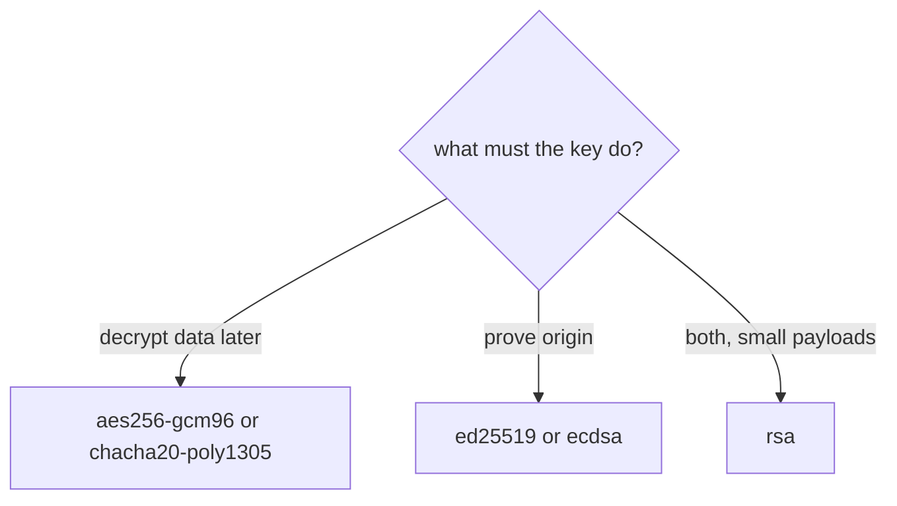

# Key Types And Key Settings

A Transit key has a type, and the type decides which operations the key supports. This part lists the types, creates keys of different types, and shows the settings that control how a key may be rotated, exported and deleted.

## Set up your terminal

The commands in this part need the Transit engine at `transit/`.

<!-- astrona:playground:renew -->

Start the port-forward in a second terminal and leave it running:

```sh
kubectl -n openbao port-forward svc/openbao 8200:8200
```

Point `bao` at the server with the lab-only root token:

```sh
export BAO_ADDR=http://openbao.localtest.me:8200
export BAO_TOKEN=$(kubectl -n openbao get secret openbao-init -o jsonpath='{.data.root-token}' | base64 -d)
```

```sh
bao secrets enable transit
```

If the engine exists, ignore the error.

## Key types

The type is chosen with `type` when the key is created. It cannot be changed afterwards.

| Type | Encrypt and decrypt | Sign and verify | HMAC | Notes |
| --- | --- | --- | --- | --- |
| `aes256-gcm96` | yes | no | yes | The default; also creates data keys |
| `aes128-gcm96` | yes | no | yes | Smaller key |
| `chacha20-poly1305` | yes | no | yes | Authenticated encryption without AES hardware |
| `ed25519` | no | yes | no | Fast signatures; no hashing option |
| `ecdsa-p256`, `ecdsa-p384`, `ecdsa-p521` | no | yes | no | Signatures on elliptic curves |
| `rsa-2048`, `rsa-3072`, `rsa-4096` | yes | yes | no | Public-key encryption and signatures; small payloads only |

Create one key of each kind you need and read it:

```sh
bao write -f transit/keys/orders-aes
bao write transit/keys/orders-chacha type=chacha20-poly1305
bao write transit/keys/orders-rsa type=rsa-3072
bao list transit/keys
bao read transit/keys/orders-rsa
```

The read of an RSA key shows the public key for each version under `keys`. Encrypt with the RSA key and try a signature with the AES key:

```sh
bao write transit/encrypt/orders-rsa plaintext=$(printf '%s' 'hello' | base64)
bao write transit/sign/orders-aes input=$(printf '%s' 'hello' | base64)
```

The first call works. The second is refused, because an AES key cannot sign. Use a symmetric key for data that the application decrypts, and a signature key for proving where data came from.

## Settings you can change

Settings live at `transit/keys/<name>/config`:

```sh
bao write transit/keys/orders-aes/config auto_rotate_period=720h
bao read -field=auto_rotate_period transit/keys/orders-aes
```

With `auto_rotate_period` set, OpenBao creates a new key version on its own after that time. Zero turns it off. Other settings of this path are:

| Setting | Effect |
| --- | --- |
| `min_decryption_version` | The oldest version that may decrypt |
| `min_encryption_version` | The oldest version that may encrypt; 0 means always the latest |
| `deletion_allowed` | Must be `true` before the key can be deleted |
| `exportable` | Allows reading the key material; once true it cannot be turned off |
| `allow_plaintext_backup` | Allows a backup that contains the key material; once true it cannot be turned off |

## Delete a key

A key is protected from deletion until you say otherwise, because everything encrypted with it becomes unreadable:

```sh
bao delete transit/keys/orders-chacha
bao write transit/keys/orders-chacha/config deletion_allowed=true
bao delete transit/keys/orders-chacha
```

The first delete is refused. After `deletion_allowed=true`, the second delete removes the key and all of its versions for good.



The diagram shows how the need decides the key type.

You can now choose a key type and set the controls around it. The next part makes one key serve many users.

## Common pitfalls

> [!WARNING]
> - **Creating a key with the wrong type.** The type is fixed; create a new key and migrate the data.
> - **Making a key `exportable` "just in case".** The key material can then leave OpenBao, and the setting cannot be undone.
> - **Deleting a key to "clean up".** Data encrypted with it cannot be recovered.
> - **Encrypting large files with an RSA key.** RSA handles small payloads; use a data key for large data.
