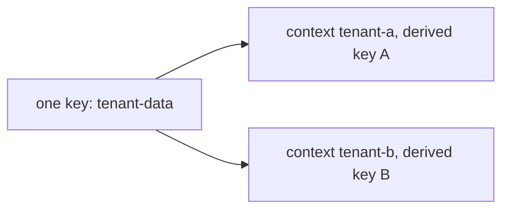

# Context, Convergent Encryption And Batch Requests

One key can serve many users when each user gets a different derived key. Some applications also need to find a record by its ciphertext, which normal encryption does not allow. This part covers derived keys with a context, convergent encryption, and batch requests for many items in one call.

## Set up your terminal

The commands in this part need the Transit engine at `transit/`.

<!-- astrona:playground:renew -->

Start the port-forward in a second terminal and leave it running:

```sh
kubectl -n openbao port-forward svc/openbao 8200:8200
```

Point `bao` at the server with the lab-only root token:

```sh
export BAO_ADDR=http://openbao.localtest.me:8200
export BAO_TOKEN=$(kubectl -n openbao get secret openbao-init -o jsonpath='{.data.root-token}' | base64 -d)
```

```sh
bao secrets enable transit
```

If the engine exists, ignore the error.

## Derived keys and context

A key created with `derived=true` does not encrypt with its own key material directly. For each request it derives a key from the key material and a **context** that the caller sends, which must be Base64 encoded:

```sh
bao write transit/keys/tenant-data derived=true
CTX_A=$(printf '%s' 'tenant-a' | base64)
CTX_B=$(printf '%s' 'tenant-b' | base64)
CT=$(bao write -field=ciphertext transit/encrypt/tenant-data \
    plaintext=$(printf '%s' 'invoice 42' | base64) context="$CTX_A")
echo "$CT"
```

Decrypt with the right context and with another one:

```sh
bao write -field=plaintext transit/decrypt/tenant-data ciphertext="$CT" context="$CTX_A" | base64 -d
bao write transit/decrypt/tenant-data ciphertext="$CT" context="$CTX_B"
```

The first call returns `invoice 42`. The second fails, because tenant B derives a different key. The context is not secret, but it must be the same on encrypt and on decrypt, so the application has to store or recompute it. A request without a context on a derived key is refused.

## Same plaintext, different ciphertext

Encrypt the same text twice with a normal derived key:

```sh
for i in 1 2; do
  bao write -field=ciphertext transit/encrypt/tenant-data \
    plaintext=$(printf '%s' 'invoice 42' | base64) context="$CTX_A"
done
```

The two ciphertexts differ, because each encryption uses a fresh random nonce. This protects against a reader who compares ciphertexts, and it also means an application cannot search for a record by encrypting the value it looks for.

## Convergent encryption

When a key is created with `convergent_encryption=true`, the nonce is derived from the plaintext and the context, so the same input always gives the same ciphertext. The setting needs `derived=true`:

```sh
bao write transit/keys/lookup-email derived=true convergent_encryption=true
for i in 1 2; do
  bao write -field=ciphertext transit/encrypt/lookup-email \
    plaintext=$(printf '%s' 'anna@example.com' | base64) context="$CTX_A"
done
```

Both lines are now identical. The application can encrypt a search value and look for an exact match in its database. The price is that anyone who sees the stored ciphertexts can tell which records hold equal values. Use convergent encryption only for fields that need an exact-match lookup, with a context that is separate for each kind of data.

## Batch requests

A single call can handle many items. The input is a JSON list in `batch_input`, and the answer is a list in `batch_results`, in the same order:

```sh
cat > batch.json <<'JSON'
[
  {"plaintext": "b3JkZXItMTAwMQ==", "context": "dGVuYW50LWE="},
  {"plaintext": "b3JkZXItMTAwMg==", "context": "dGVuYW50LWE="}
]
JSON
bao write -format=json transit/encrypt/tenant-data batch_input=@batch.json | jq '.data.batch_results'
```

Each result holds a `ciphertext`, or an `error` for an item that failed, so one bad item does not fail the others. The same works for decrypt with `ciphertext` in each item, and for rewrap. Batching saves a round trip for each item and is the right way to migrate many records.



The diagram shows that one key produces a separate derived key for each context.

You can now use a key for many users, search on encrypted values, and process records in bulk. That completes the Transit basics of this module.

## Common pitfalls

> [!WARNING]
> - **Losing the context.** Without the same context, a derived key cannot decrypt.
> - **Using convergent encryption for everything.** Equal values become visible as equal ciphertexts.
> - **Forgetting that context is Base64 encoded.** The plaintext and the context both need Base64.
> - **Ignoring errors inside `batch_results`.** The call as a whole can succeed while single items fail.
