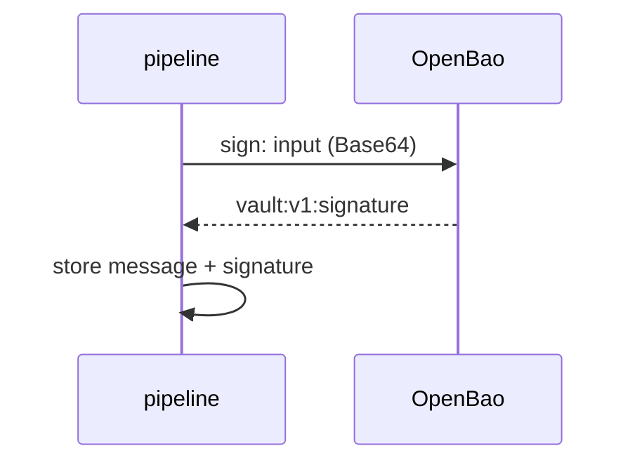

# Signing Keys And Signatures

A signature is made with a private key and checked with the matching public key. Transit keeps the private key, so only OpenBao can sign, and anyone with the public key or with access to Transit can verify. This part creates a key meant for signing, signs a message, and reads the signature.

## Set up your terminal

The commands in this part need the Transit engine at `transit/`.

<!-- astrona:playground:renew -->

Start the port-forward in a second terminal and leave it running:

```sh
kubectl -n openbao port-forward svc/openbao 8200:8200
```

Point `bao` at the server with the lab-only root token:

```sh
export BAO_ADDR=http://openbao.localtest.me:8200
export BAO_TOKEN=$(kubectl -n openbao get secret openbao-init -o jsonpath='{.data.root-token}' | base64 -d)
```

```sh
bao secrets enable transit
```

If the engine exists, ignore the error.

## Choose a key type

The type is chosen when the key is created and cannot change later. The signing types are these:

| Type | Notes |
| --- | --- |
| `ed25519` | Small keys and signatures, fast, no hash algorithm to choose. A good default for new systems. |
| `ecdsa-p256` | Widely supported elliptic-curve signatures. Also `ecdsa-p384` and `ecdsa-p521`. |
| `rsa-2048` | Widely supported. Also `rsa-3072` and `rsa-4096`. Larger keys are slower. |

The default type, `aes256-gcm96`, can encrypt but cannot sign. Create a signing key:

```sh
bao write -f transit/keys/release-signing type=ed25519
bao read transit/keys/release-signing
```

The read shows `type`, `supports_signing` of `true`, `latest_version` of `1`, and the public key of each version under `keys`. The private key is never shown.

## Sign a message

Transit signs bytes, so the input must be Base64-encoded, as for encryption:

```sh
INPUT=$(printf '%s' '{"release":"1.4.0"}' | base64)
bao write -field=signature transit/sign/release-signing input="$INPUT"
```

The signature starts with `vault:v1:`, followed by Base64 text. As for ciphertext, `vault` is kept for compatibility and `v1` is the key version that signed. The signature does not contain the message, so the application stores the message and the signature together.

## Read the public key

Someone who must verify without calling OpenBao needs the public key. It is in the key read, under the version:

```sh
bao read -format=json transit/keys/release-signing | jq -r '.data.keys["1"].public_key'
```

For `ed25519` the value is the public key in Base64. For `rsa` and `ecdsa` keys it is a PEM block.



The diagram shows that the pipeline sends the data to sign, and receives a signature, while the key stays in OpenBao.

You can now sign. A signature is only useful if someone checks it, and the next part does that.

## Common pitfalls

> [!WARNING]
> - **Creating the key with the default type.** An `aes256-gcm96` key cannot sign. The error says that the key does not support signing, and the type cannot be changed, so create a new key.
> - **Sending plain text as `input`.** Transit expects Base64. Encode it first.
> - **Signing a different byte sequence than you verify.** A trailing newline changes the signature. Sign and verify exactly the same bytes.
