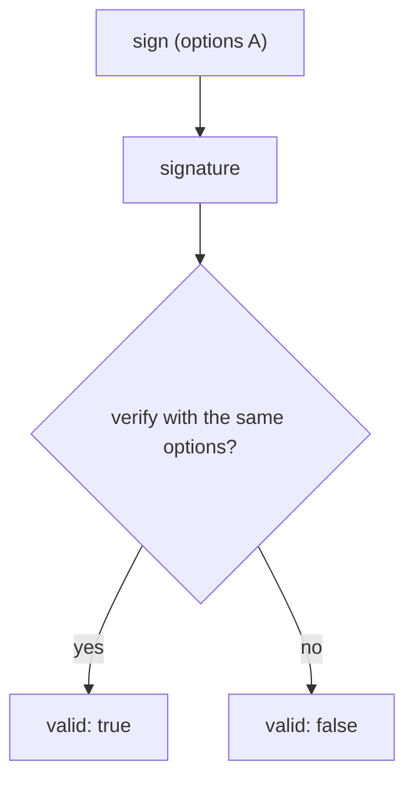

# Verifying, Versions And Signature Options

Verifying is the reason to sign. This part verifies a signature, changes the message to see it fail, rotates the key to see what happens to old signatures, and then looks at the options that must match between signer and verifier.

## Set up your terminal

The commands in this part need the Transit engine with the key `release-signing`.

<!-- astrona:playground:renew -->

Start the port-forward in a second terminal and leave it running:

```sh
kubectl -n openbao port-forward svc/openbao 8200:8200
```

Point `bao` at the server with the lab-only root token:

```sh
export BAO_ADDR=http://openbao.localtest.me:8200
export BAO_TOKEN=$(kubectl -n openbao get secret openbao-init -o jsonpath='{.data.root-token}' | base64 -d)
```

```sh
bao secrets enable transit
bao write -f transit/keys/release-signing type=ed25519
```

If the engine and key exist, ignore the errors.

## Verify a signature

Sign a message and verify it with the same key. The verify request takes the input and the signature:

```sh
INPUT=$(printf '%s' '{"release":"1.4.0"}' | base64)
SIGNATURE=$(bao write -field=signature transit/sign/release-signing input="$INPUT")
bao write transit/verify/release-signing input="$INPUT" signature="$SIGNATURE"
```

The answer has `valid` set to `true`. Now change the input by one character and verify again:

```sh
BAD=$(printf '%s' '{"release":"1.4.1"}' | base64)
bao write transit/verify/release-signing input="$BAD" signature="$SIGNATURE"
```

`valid` is `false`. A failed verification is a normal answer, not an error: the request succeeds and reports the result, so the caller must check `valid`.

## Rotate the key

Rotation adds a version. New signatures use the latest version, and old signatures still verify, because Transit keeps the old public keys:

```sh
bao write -f transit/keys/release-signing/rotate
NEW=$(bao write -field=signature transit/sign/release-signing input="$INPUT")
echo "$SIGNATURE" | cut -d: -f1,2
echo "$NEW" | cut -d: -f1,2
bao write transit/verify/release-signing input="$INPUT" signature="$SIGNATURE"
```

The first signature starts with `vault:v1`, the new one with `vault:v2`, and the old signature still verifies. To sign with an older version on purpose, pass `key_version=1` to `transit/sign`.

## Options that must match

Some options change the signature, so signer and verifier must use the same:

| Option | Applies to | Meaning |
| --- | --- | --- |
| `hash_algorithm` | RSA, ECDSA | The hash of the input. The default is `sha2-256`. Send the same value to `verify`. |
| `signature_algorithm` | RSA | `pss` (the default) or `pkcs1v15`. |
| `prehashed` | all | `true` means that the input is already a hash, not the message. |
| `marshaling_algorithm` | ECDSA | `asn1` (the default) or `jws`, the form used in JSON Web Signatures. |

A verify with the wrong option reports `valid` as `false` even though the signature is correct. When a verification fails, compare these options before you suspect the data.



The diagram shows that the same options on both sides are needed, or a correct signature looks invalid.

You can now sign and verify, and you know what changes with versions and options. Transit also offers operations that do not use a signature, and the next part covers them.

## Common pitfalls

> [!WARNING]
> - **Treating HTTP 200 as success.** A verify request returns 200 for an invalid signature. Check `valid`.
> - **Using different `hash_algorithm` values.** The signature is then reported as invalid.
> - **Assuming a rotation breaks old signatures.** It does not. Old versions keep verifying, so rotate on a schedule.
