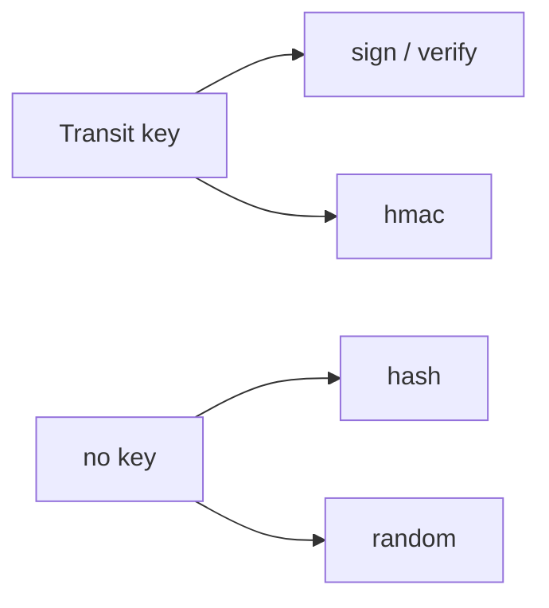

# HMAC, Hashing And Random Bytes

A signature needs a key pair. When both sides can share a secret, a keyed hash is simpler: a message authentication code, or HMAC. Transit also offers plain hashes and a random byte source. This part uses all three and says when to choose each.

## Set up your terminal

The commands in this part need the Transit engine with the key `webhook-key`.

<!-- astrona:playground:renew -->

Start the port-forward in a second terminal and leave it running:

```sh
kubectl -n openbao port-forward svc/openbao 8200:8200
```

Point `bao` at the server with the lab-only root token:

```sh
export BAO_ADDR=http://openbao.localtest.me:8200
export BAO_TOKEN=$(kubectl -n openbao get secret openbao-init -o jsonpath='{.data.root-token}' | base64 -d)
```

```sh
bao secrets enable transit
bao write -f transit/keys/webhook-key
```

If the engine and key exist, ignore the errors.

## HMAC

An HMAC takes a message and a secret key and returns a short value. Anyone who has the key can compute and check it; anyone who does not cannot. Transit computes it with a Transit key, so the secret never leaves OpenBao:

```sh
INPUT=$(printf '%s' 'payload=42' | base64)
bao write -field=hmac transit/hmac/webhook-key input="$INPUT"
```

The answer starts with `vault:v1:`. The default hash is SHA-256, and another hash can be part of the path: `transit/hmac/webhook-key/sha2-512`. To check a value, send it to the verify endpoint with `hmac` instead of `signature`:

```sh
HMAC=$(bao write -field=hmac transit/hmac/webhook-key input="$INPUT")
bao write transit/verify/webhook-key input="$INPUT" hmac="$HMAC"
```

The result has `valid` set to `true`. Use HMAC when one service creates a value and the same service, or a service that trusts the same OpenBao, checks it, for example a webhook signature or a signed cookie. Use a signature when the checker must not be able to create values.

## Hash

`transit/hash` computes a plain hash, with no key:

```sh
bao write -field=sum transit/hash/sha2-256 input="$INPUT"
bao write -field=sum transit/hash/sha2-512 input="$INPUT" format=base64
```

The first command prints the SHA-256 in hexadecimal and the second in Base64. A hash has no secret, so anyone can compute it. It is useful when a system that has no hash tool needs a digest, but it adds no protection.

## Random bytes

`transit/random` returns bytes from the random source of OpenBao:

```sh
bao write -field=random_bytes transit/random/32 format=base64
bao write -field=random_bytes transit/random/16 format=hex
```

The number in the path is the count of bytes. The default format is Base64. Use it for tokens and salts when the application has no good source of its own.

## Which operation to choose

| Need | Operation |
| --- | --- |
| Prove who wrote the data, and the checker must not be able to write | `sign` and `verify` |
| Prove the data is unchanged, and the checker may also create it | `hmac` |
| A digest for a system without a hash tool | `hash` |
| Unpredictable bytes | `random` |



The diagram shows that signing and HMAC use a Transit key, while hash and random do not need one.

You can now use every Transit operation that does not encrypt. The last part controls who may use them.

## Common pitfalls

> [!WARNING]
> - **Comparing HMACs with a string comparison in your own code.** A normal comparison can leak timing. Verify through Transit or use a constant-time comparison.
> - **Using `hash` as if it were a protection.** Anyone can recompute it.
> - **Forgetting Base64 for `input`.** Plain text is refused.
