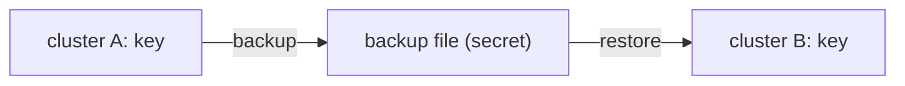

# Access Control, Export And Backup

Transit is safe because the key stays inside OpenBao, but a policy that allows every operation on every key removes that benefit. This part writes a policy per role, shows what export and backup do to the safety of a key, and moves a key between clusters.

## Set up your terminal

The commands in this part need the Transit engine with the key `release-signing` of type `ed25519`.

<!-- astrona:playground:renew -->

Start the port-forward in a second terminal and leave it running:

```sh
kubectl -n openbao port-forward svc/openbao 8200:8200
```

Point `bao` at the server with the lab-only root token:

```sh
export BAO_ADDR=http://openbao.localtest.me:8200
export BAO_TOKEN=$(kubectl -n openbao get secret openbao-init -o jsonpath='{.data.root-token}' | base64 -d)
```

```sh
bao secrets enable transit
bao write -f transit/keys/release-signing type=ed25519
```

If the engine and key exist, ignore the errors.

## One policy per role

Each Transit operation is its own path, so a policy can allow signing without allowing anything else. Write a policy for the pipeline that signs, and one for services that only verify:

```sh
printf 'path "transit/sign/release-signing" {\n  capabilities = ["update"]\n}\npath "transit/verify/release-signing" {\n  capabilities = ["update"]\n}\n' | bao policy write release-signer -
printf 'path "transit/verify/release-signing" {\n  capabilities = ["update"]\n}\n' | bao policy write release-verifier -
```

Transit endpoints take a write, so the capability is `update`. Test the verifier policy with a token that has it:

```sh
VERIFIER=$(bao token create -policy=release-verifier -ttl=10m -field=token)
INPUT=$(printf '%s' 'x' | base64)
BAO_TOKEN="$VERIFIER" bao write transit/sign/release-signing input="$INPUT"
```

The sign request fails with `permission denied`, and a verify request with the same token works. The same pattern separates `encrypt` from `decrypt`: an application that stores data may encrypt but not decrypt.

## Keep the key inside

A key can be marked `exportable=true` at creation. An exportable key can be read out with `transit/export/<type>-key/<name>`, which puts the key material in the response. `allow_plaintext_backup=true` lets the backup contain key material that can be restored as plain data. Both settings are fixed once true and defeat the main reason to use Transit, so leave them off unless you have a reason, and write a policy that denies the export paths.

Try it with a throwaway key:

```sh
bao write transit/keys/throwaway type=ed25519 exportable=true allow_plaintext_backup=true
bao read -format=json transit/export/signing-key/throwaway/1 | jq '.data.keys | keys'
bao write transit/keys/release-signing/config deletion_allowed=true
```

The export returns the key. The non-exportable key `release-signing` returns an error for the same request. The last command allows deleting the key; keys cannot be deleted until `deletion_allowed` is set, which prevents a mistaken `bao delete`.

## Backup and restore

A Transit key can be moved to another cluster with a backup:

```sh
bao read -field=backup transit/backup/throwaway > throwaway.backup
bao write transit/restore/throwaway-copy backup=@throwaway.backup
```

The backup holds all versions of the key. The restore needs a name that is not already in use, or the `force` option. Treat a backup file as a secret, because anyone who has it and can restore it can use the key. Whether a key can be backed up depends on its `exportable` and `allow_plaintext_backup` settings, so if a backup request is refused, read the error and the key settings first.



The diagram shows that a backup moves all versions of a key from one cluster to another through a file.

You can now control who signs, who verifies and how a key can leave OpenBao. This completes the module.

## Common pitfalls

> [!WARNING]
> - **One policy for every operation.** A service that only verifies should not be able to sign.
> - **Marking keys exportable by habit.** It cannot be undone.
> - **Leaving backup files in a shared folder.** Treat them like the key.

## Your mission: Sign And Verify A Release Manifest With Transit

You can now sign, verify, hash and limit who may use a key. The graded lab gives you a release manifest and an empty Transit engine, and asks you to create a signing key, publish a signature of the manifest, and give verifiers a policy that cannot sign.

The lab runs in its own cluster, so first pause your playground. Nothing in it is lost:

```sh
astrona stop ats-114-playground-040-02
```

Then start the lab:

```sh
astrona run --git ssh://git@github.com/astrona-io/ATS114.git -c sections/section-040/module-02/labs/lab-01
```

The task is on the next page. Solve it on your own first. When you think you are done, send it for grading:

```sh
astrona submit -c sections/section-040/module-02/labs/lab-01
```

When the lab is done, remove it and start your playground again:

```sh
astrona destroy ats-114-lab-040-02
astrona start ats-114-playground-040-02
```
