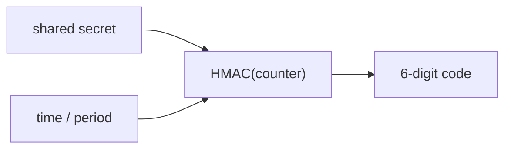

# How TOTP Works

A time-based one-time password is a short number that changes every 30 seconds. Both sides know a shared secret and the current time, so both can compute the same number, and no number is sent in advance. This part explains the calculation and creates the first key.

## Set up your terminal

The commands in this part need the TOTP engine at `totp/`.

<!-- astrona:playground:renew -->

Start the port-forward in a second terminal and leave it running:

```sh
kubectl -n openbao port-forward svc/openbao 8200:8200
```

Point `bao` at the server with the lab-only root token:

```sh
export BAO_ADDR=http://openbao.localtest.me:8200
export BAO_TOKEN=$(kubectl -n openbao get secret openbao-init -o jsonpath='{.data.root-token}' | base64 -d)
```

```sh
bao secrets enable totp
```

If the engine exists, ignore the error.

## The calculation

The code is computed from three inputs:

1. The shared secret, a random value that is Base32-encoded when it is shown to a person.
2. The current time, divided by the **period** (30 seconds by default), which gives a counter that changes once per period.
3. A keyed hash (HMAC) of the counter with the secret, which is cut down to a number with a fixed count of **digits** (6 by default).

The hash algorithm is `SHA1` by default, because most authenticator apps expect it. `SHA256` and `SHA512` are possible, but an app that does not support them shows wrong codes. For the same reason, 6 digits and 30 seconds are the safest choice for interoperability.

## Create a key

A key in the TOTP engine is one secret and its settings. Create a key that OpenBao generates for a person:

```sh
bao write totp/keys/alice generate=true issuer=Inventory account_name=alice@inventory.example
```

The response has two fields. `url` is an `otpauth://` URL that holds the secret and the settings. `barcode` is a Base64-encoded PNG image of the same URL as a QR code. A person scans the QR code with an authenticator app, or the URL is typed in. Both contain the secret, so show them once and do not store them.

Read the key back:

```sh
bao read totp/keys/alice
```

The read shows `account_name`, `algorithm`, `digits`, `issuer` and `period`, and never the secret. List the keys of the engine:

```sh
bao list totp/keys
```

## What the URL contains

Print the URL and look at its parts:

```sh
bao write -field=url totp/keys/bob generate=true issuer=Inventory account_name=bob@inventory.example
```

The URL has the form `otpauth://totp/Inventory:bob@inventory.example?secret=...&issuer=Inventory&algorithm=SHA1&digits=6&period=30`. The label holds the issuer and the account name, and the query holds the secret and the settings. An authenticator app reads all of it from the QR code.



The diagram shows that the secret and the time together produce the code, so no code is stored or sent in advance.

You can now create keys. The next part generates and validates codes with them.

## Common pitfalls

> [!WARNING]
> - **Keeping the QR code or URL.** Both hold the secret. Show it to the person once.
> - **Choosing unusual settings and testing only on your own app.** Not all apps support `SHA256`, 8 digits or other periods.
> - **Letting clocks drift.** TOTP depends on the time. A server or phone whose clock is off by more than a period produces codes that do not match.
