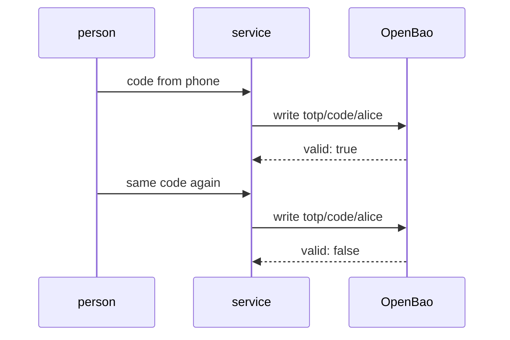

# Generating And Validating Codes

With a key in place, OpenBao can produce the current code and can check a code that someone typed. Both use the same path, `totp/code/<name>`, and the HTTP verb decides which. This part uses both and shows what the answer means.

## Set up your terminal

The commands in this part need the TOTP engine with the key `alice`.

<!-- astrona:playground:renew -->

Start the port-forward in a second terminal and leave it running:

```sh
kubectl -n openbao port-forward svc/openbao 8200:8200
```

Point `bao` at the server with the lab-only root token:

```sh
export BAO_ADDR=http://openbao.localtest.me:8200
export BAO_TOKEN=$(kubectl -n openbao get secret openbao-init -o jsonpath='{.data.root-token}' | base64 -d)
```

```sh
bao secrets enable totp
bao write totp/keys/alice generate=true issuer=Inventory account_name=alice@inventory.example
```

If the engine and key exist, ignore the errors.

## Generate a code

A read of `totp/code/<name>` returns the code for the current period:

```sh
bao read totp/code/alice
```

The answer has one field, `code`, a six-digit number. Run the command again within the same 30 seconds and you get the same number. Wait for the next period and the number changes.

This is the authenticator role: OpenBao holds the secret and plays the role of the phone. Use it when a script needs a second factor for another system and a person is not there to read it from a phone.

## Validate a code

A write to `totp/code/<name>` checks a code against the key:

```sh
CODE=$(bao read -field=code totp/code/alice)
bao write totp/code/alice code="$CODE"
bao write totp/code/alice code=000000
```

The first write answers with `valid` set to `true`, and the second with `false`. As with signatures in the Transit engine, a wrong code is a normal answer and not an error, so the caller must read `valid`.

This is the server role: a person types the code from their phone and a service asks OpenBao whether it is right.

## Skew and replay

Phones and servers have small differences in time. The key's `skew` setting (`0` or `1`, default `1`) lets the validation accept codes from one period before and one period after the current one. A skew of 1 makes logins easier and also makes a stolen code useful for longer, so use 0 if the clocks are reliable.

A code that was accepted once cannot be accepted again in the same period. Validate the same code twice quickly:

```sh
CODE=$(bao read -field=code totp/code/alice)
bao write -field=valid totp/code/alice code="$CODE"
bao write -field=valid totp/code/alice code="$CODE"
```

The first answer is `true` and the second is `false`, because OpenBao remembers the code it accepted. This protects against someone who sees a code and tries it right after the person. The code from the previous commands was already accepted, so wait for the next period before you run these three commands, or the first answer is `false` too.



The diagram shows that the service sends the typed code to OpenBao and trusts the `valid` answer, and that a reused code fails.

You can now generate and validate codes. A key can also come from outside, and the next part covers that.

## Common pitfalls

> [!WARNING]
> - **Checking only that the request succeeded.** An invalid code returns a normal answer. Read `valid`.
> - **Retrying a code on failure.** A code accepted once is refused again, so a retry of a valid code looks like a failure.
> - **Raising `skew` to fix clock problems.** Fix the clocks instead.
