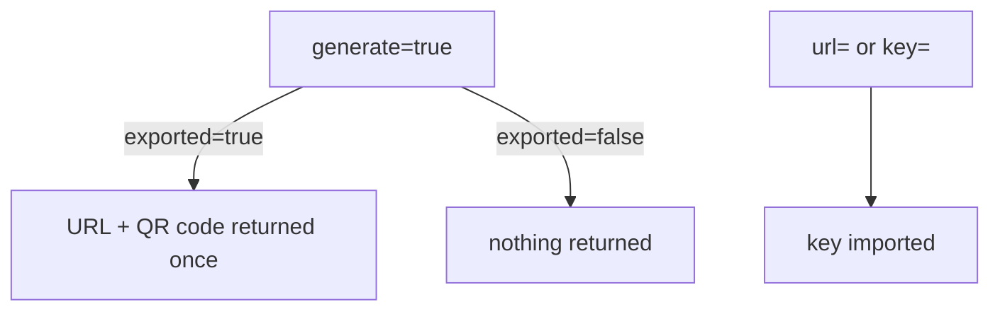

# Provider And Consumer Modes

So far OpenBao created the secret. Often the secret already exists: another system created it, or a person has it in an authenticator app. The engine can import such a key. This part imports a key from a URL and from a Base32 secret, and uses the `exported` setting to keep a generated secret from ever being returned.

## Set up your terminal

The commands in this part need the TOTP engine.

<!-- astrona:playground:renew -->

Start the port-forward in a second terminal and leave it running:

```sh
kubectl -n openbao port-forward svc/openbao 8200:8200
```

Point `bao` at the server with the lab-only root token:

```sh
export BAO_ADDR=http://openbao.localtest.me:8200
export BAO_TOKEN=$(kubectl -n openbao get secret openbao-init -o jsonpath='{.data.root-token}' | base64 -d)
```

```sh
bao secrets enable totp
```

If the engine exists, ignore the error.

## Import from a URL

When a system shows you an `otpauth://` URL, give the URL to OpenBao. It takes the secret and the settings from it:

```sh
bao write totp/keys/partner-url \
    url="otpauth://totp/Partner:ops@partner.example?secret=JBSWY3DPEHPK3PXP&issuer=Partner"
bao read totp/keys/partner-url
```

The read shows the issuer `Partner`, the account name, and the default algorithm, digits and period, because the URL did not set them. `JBSWY3DPEHPK3PXP` is a well-known example secret; never use it for anything real.

## Import from a Base32 secret

When you only have the secret, pass it as `key` together with the settings:

```sh
bao write totp/keys/partner-key \
    key=JBSWY3DPEHPK3PXP \
    issuer=Partner account_name=ops@partner.example
```

Both keys now hold the same secret and the same settings, so they produce the same code:

```sh
bao read -field=code totp/code/partner-url
bao read -field=code totp/code/partner-key
```

The two numbers match, provided no period boundary falls between the two commands. Run them again if they differ.

## Do not return the secret

A generated key returns its URL and QR code once. Set `exported=false` and it returns neither:

```sh
bao write totp/keys/service-account generate=true exported=false \
    issuer=Inventory account_name=service-account
```

The response is empty. The secret exists only inside OpenBao, which means nobody can put it in an app. Use this for a key that OpenBao itself uses to generate codes, for example for a script that needs a second factor, and where no person should ever hold the secret.

## Other settings

The settings below can be chosen when a key is created. They cannot be changed afterwards; create a new key to change them.

| Setting | Meaning |
| --- | --- |
| `period` | Seconds per code, default 30 |
| `digits` | `6` or `8`, default 6 |
| `algorithm` | `SHA1`, `SHA256` or `SHA512`, default `SHA1` |
| `key_size` | Bytes of the generated secret, default 20 |
| `skew` | Periods accepted on each side when validating, `0` or `1`, default 1 |



The diagram shows the three ways a key is created and which of them returns the secret.

You can now create TOTP keys from any source. The last part controls who can use them.

## Common pitfalls

> [!WARNING]
> - **Importing a secret and leaving it in a shell history or a ticket.** Remove it after the import.
> - **Using `exported=false` and then expecting to enrol a phone.** Nothing can be shown, so create an exported key for people.
> - **Changing settings of an existing key.** They are fixed. Create a new key and replace the old one.
