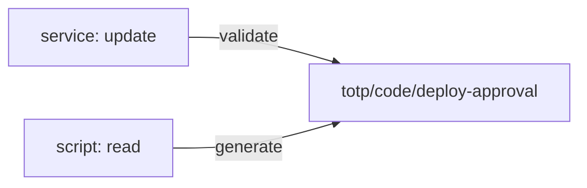

# Access Control And Operations

A service that only has to check codes should not be able to generate them, because anyone who can generate a code does not need the phone. The engine uses the same path for both, but the HTTP verb differs, and a policy can tell them apart. This part writes such a policy and removes a key.

## Set up your terminal

The commands in this part need the TOTP engine with the key `deploy-approval`.

<!-- astrona:playground:renew -->

Start the port-forward in a second terminal and leave it running:

```sh
kubectl -n openbao port-forward svc/openbao 8200:8200
```

Point `bao` at the server with the lab-only root token:

```sh
export BAO_ADDR=http://openbao.localtest.me:8200
export BAO_TOKEN=$(kubectl -n openbao get secret openbao-init -o jsonpath='{.data.root-token}' | base64 -d)
```

```sh
bao secrets enable totp
bao write totp/keys/deploy-approval generate=true exported=false issuer=Inventory account_name=release-manager
```

If the engine and key exist, ignore the errors.

## Read and update are different

On `totp/code/<name>`:

| Verb | Capability | Result |
| --- | --- | --- |
| `bao read` | `read` | Generates the current code |
| `bao write code=...` | `update` | Validates a code |

A policy for the service that checks codes allows only `update`:

```sh
printf 'path "totp/code/deploy-approval" {\n  capabilities = ["update"]\n}\n' | bao policy write totp-validator -
```

Test it with a token that has the policy:

```sh
VALIDATOR=$(bao token create -policy=totp-validator -ttl=10m -field=token)
CODE=$(bao read -field=code totp/code/deploy-approval)
BAO_TOKEN="$VALIDATOR" bao write totp/code/deploy-approval code="$CODE"
BAO_TOKEN="$VALIDATOR" bao read totp/code/deploy-approval
```

The write answers with `valid` set to `true`. The read fails with `permission denied`. Give the capability `read` to an identity only when it plays the authenticator, for example a deployment script.

## Manage keys

Keys are paths under `totp/keys/`, so a policy can allow management separately:

```sh
bao list totp/keys
bao delete totp/keys/deploy-approval
```

Deleting a key removes the secret for good. Codes from phones that had it stop being accepted at once. Create a replacement and enrol the people again before you delete a key that people use.

## Mounting and auditing

Mount the engine at a path that tells its purpose, for example `bao secrets enable -path=totp-prod totp`, and give each application its own keys.



The diagram shows that validating and generating are the same path with different verbs, so a policy can allow one without the other.

You can now create keys in every mode and limit what each identity may do. This completes the module.

## Common pitfalls

> [!WARNING]
> - **Giving `read` to a service that only validates.** It can then generate its own valid code.
> - **Deleting a key that people still use.** Their codes stop working immediately.
> - **Using one key for several people.** Create one key per person or per use, so you can remove one without affecting the others.

## Your mission: Set Up Time-Based One-Time Passwords

You can now create TOTP keys in every mode, generate and validate codes, and separate the two in a policy. The graded lab asks you to enable the TOTP engine, create a generated key with specific settings, import a partner secret, and add a policy that can only validate.

The lab runs in its own cluster, so first pause your playground. Nothing in it is lost:

```sh
astrona stop ats-114-playground-050-01
```

Then start the lab:

```sh
astrona run --git ssh://git@github.com/astrona-io/ATS114.git -c sections/section-050/module-01/labs/lab-01
```

The task is on the next page. Solve it on your own first. When you think you are done, send it for grading:

```sh
astrona submit -c sections/section-050/module-01/labs/lab-01
```

When the lab is done, remove it and start your playground again:

```sh
astrona destroy ats-114-lab-050-01
astrona start ats-114-playground-050-01
```
