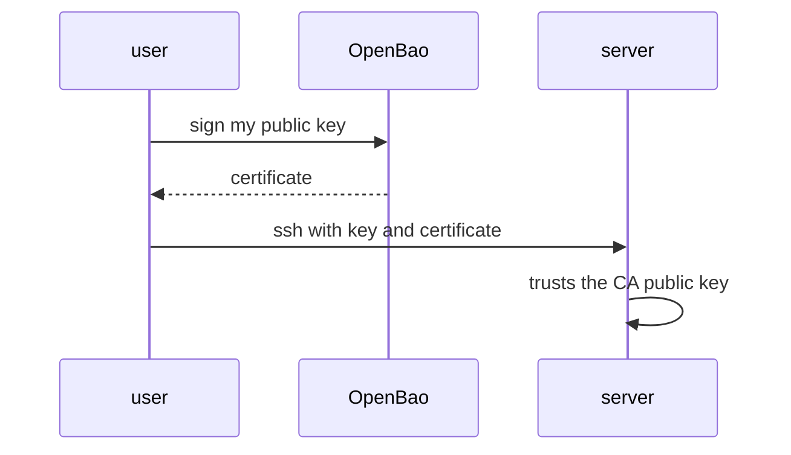

# Two Ways To Authenticate

The SSH engine supports two credential types. Each solves the same problem, the permanent public key on every server, and each needs something different from the server. This part compares them, enables the engine, and generates the key of the certificate authority.

## Set up your terminal

The commands in this part need the port-forward running in a second terminal.

<!-- astrona:playground:renew -->

Start the port-forward in a second terminal and leave it running:

```sh
kubectl -n openbao port-forward svc/openbao 8200:8200
```

Point `bao` at the server with the lab-only root token:

```sh
export BAO_ADDR=http://openbao.localtest.me:8200
export BAO_TOKEN=$(kubectl -n openbao get secret openbao-init -o jsonpath='{.data.root-token}' | base64 -d)
```

## The two modes

| Mode | What the user gets | What the server needs |
| --- | --- | --- |
| Signed certificates (`key_type=ca`) | A certificate for the user's own public key, valid for a short time | One line in `sshd_config` that trusts the CA public key |
| One-time password (`key_type=otp`) | A password that works for one login | The helper `vault-ssh-helper`, which checks the password with OpenBao |

Signed certificates are the simpler and stronger choice for modern servers: nothing needs to change on the server for each user, and there is no network call at login time. One-time passwords are for servers or devices that cannot use certificates. The engine had a third mode that stored and rotated static keys; this course does not use it.

## Enable the engine

```sh
bao secrets enable ssh
```

The engine is mounted at `ssh/`. A mount can hold one CA key and any number of roles.

## Generate the CA key

The CA key signs user certificates. Let OpenBao create it:

```sh
bao write ssh/config/ca generate_signing_key=true
```

The answer contains the `public_key`. The private key stays inside OpenBao and cannot be read. Read the public key again whenever you need to install it on a server:

```sh
bao read -field=public_key ssh/config/ca
```

The key is also available without a token at `ssh/public_key`, so a configuration management tool can fetch it:

```sh
curl -s "$BAO_ADDR/v1/ssh/public_key"
```

You can use your own CA key instead, by writing `private_key` and `public_key` to `ssh/config/ca`. A key generated inside OpenBao is better, because no copy of the private key exists anywhere else. A configuration holds only one CA key; writing `generate_signing_key=true` when one exists returns an error.

## Trust the CA on a server

On each server, save the public key to a file and point `sshd` to it:

```sh
bao read -field=public_key ssh/config/ca > /etc/ssh/trusted-user-ca-keys.pem
echo 'TrustedUserCAKeys /etc/ssh/trusted-user-ca-keys.pem' >> /etc/ssh/sshd_config
```

After a reload of `sshd`, the server accepts any certificate signed by this CA, for the principals named in the certificate. This is done once per server, not once per user.



The diagram shows that the server is configured once with the CA public key, and users get a certificate from OpenBao whenever they need access.

You now have a CA. A role decides what it will sign, and the next part writes one.

## Common pitfalls

> [!WARNING]
> - **Copying the private CA key to other places.** Generate it in OpenBao so it exists nowhere else.
> - **Trusting the CA for every user of a server.** `TrustedUserCAKeys` trusts all principals the CA signs, so roles must restrict them.
> - **Replacing the CA key without planning.** Servers trust the old public key, and certificates signed after the change are rejected until each server is updated.
