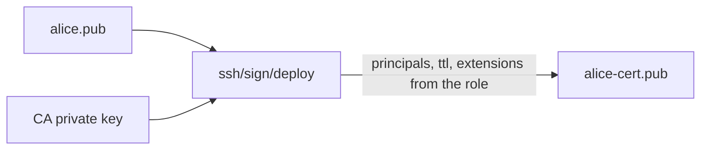

# Signing User Keys With A CA Role

The CA key exists, but nothing can be signed without a role. A role says which users the certificates may name and how long they live. This part writes a first role, signs a public key, and reads the certificate to see what it contains.

## Set up your terminal

The commands in this part need the SSH engine with a CA key. They also need a key pair for a user.

<!-- astrona:playground:renew -->

Start the port-forward in a second terminal and leave it running:

```sh
kubectl -n openbao port-forward svc/openbao 8200:8200
```

Point `bao` at the server with the lab-only root token:

```sh
export BAO_ADDR=http://openbao.localtest.me:8200
export BAO_TOKEN=$(kubectl -n openbao get secret openbao-init -o jsonpath='{.data.root-token}' | base64 -d)
```

```sh
bao secrets enable ssh
bao write ssh/config/ca generate_signing_key=true
ssh-keygen -q -t ed25519 -N "" -C "alice" -f ./alice
```

If the engine and CA key exist, ignore the errors. The last command creates `alice` (private) and `alice.pub` (public) in the current directory.

## Write a role

```sh
bao write ssh/roles/deploy -<<'JSON'
{
  "key_type": "ca",
  "allow_user_certificates": true,
  "allowed_users": "deploy,ops",
  "default_user": "deploy",
  "default_extensions": {"permit-pty": ""},
  "ttl": "30m",
  "max_ttl": "4h"
}
JSON
```

The fields do the following:

| Field | Meaning |
| --- | --- |
| `key_type` | `ca` for signed certificates |
| `allow_user_certificates` | The role may sign certificates for users (the other kind is for hosts) |
| `allowed_users` | The principals the certificate may name, comma-separated |
| `default_user` | The principal used when the request names none |
| `default_extensions` | Extensions put into the certificate; `permit-pty` lets the user open a terminal |
| `ttl`, `max_ttl` | The default and the longest lifetime of a certificate |

## Sign a key

Send the public key. OpenBao returns the certificate in `signed_key`:

```sh
bao write -field=signed_key ssh/sign/deploy public_key=@alice.pub valid_principals=deploy > alice-cert.pub
```

`ssh` finds a certificate next to the key if it is named `<key>-cert.pub`, so save it as `alice-cert.pub`. Read it:

```sh
ssh-keygen -L -f alice-cert.pub
```

The output shows the type (`user certificate`), the `Key ID`, the `Valid` period of 30 minutes, the `Principals` list with `deploy`, the critical options, and the extensions with `permit-pty`. The `Signing CA` line shows the CA key. Nothing in the certificate can be changed without breaking the signature.

## Use the certificate

With a server that trusts the CA, connect as the principal:

```sh
ssh -i alice -o CertificateFile=alice-cert.pub deploy@server.example
```

The server checks that the certificate is signed by a trusted CA, is not expired, and names `deploy`. The username `deploy` must be among the principals of the certificate. You do not need a server to see the certificate fields; reading it with `ssh-keygen -L` is enough for this part.

## Ask for a shorter life

A request can ask for a shorter lifetime than the default, and the role bounds it by `max_ttl`:

```sh
bao write -field=signed_key ssh/sign/deploy public_key=@alice.pub valid_principals=deploy ttl=5m > alice-cert.pub
ssh-keygen -L -f alice-cert.pub | grep Valid
```

The `Valid` line now covers five minutes. A request for more than `max_ttl` is refused or cut to the maximum; read the answer to see which.



The diagram shows that the role decides the content of the certificate and the CA key signs it.

You can now sign a key. Whether a role lets a user ask for anything, and which things are limited, is the subject of the next part.

## Common pitfalls

> [!WARNING]
> - **Saving the certificate under another name.** `ssh` finds `alice-cert.pub` next to `alice` automatically.
> - **Forgetting `valid_principals`.** Without it the role uses `default_user`.
> - **Using a long `max_ttl`.** A certificate cannot be revoked in a simple way; its lifetime is its only limit.
