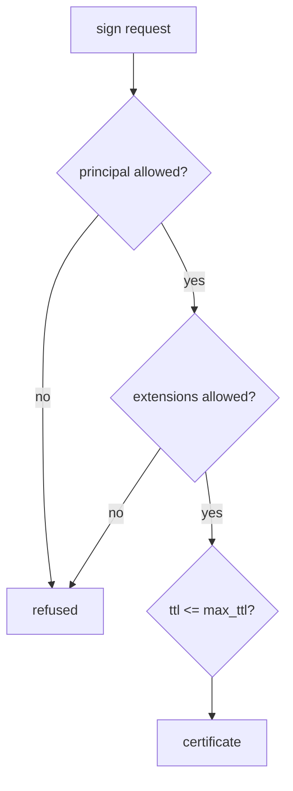

# Restricting A Role

A role with open settings is a risk: anyone who can call `ssh/sign` for it can name any principal, including `root`. This part tightens a role step by step, and tests each restriction by asking for something the role must refuse.

## Set up your terminal

The commands in this part need the SSH engine with a CA key and the role `deploy`, and a key pair for a user.

<!-- astrona:playground:renew -->

Start the port-forward in a second terminal and leave it running:

```sh
kubectl -n openbao port-forward svc/openbao 8200:8200
```

Point `bao` at the server with the lab-only root token:

```sh
export BAO_ADDR=http://openbao.localtest.me:8200
export BAO_TOKEN=$(kubectl -n openbao get secret openbao-init -o jsonpath='{.data.root-token}' | base64 -d)
```

```sh
bao secrets enable ssh
bao write ssh/config/ca generate_signing_key=true
ssh-keygen -q -t ed25519 -N "" -C "alice" -f ./alice
bao write ssh/roles/deploy -<<'JSON'
{
  "key_type": "ca",
  "allow_user_certificates": true,
  "allowed_users": "deploy,ops",
  "default_user": "deploy",
  "default_extensions": {"permit-pty": ""},
  "ttl": "30m",
  "max_ttl": "4h"
}
JSON
```

If the engine, CA key and role exist, ignore the errors.

## Principals

`allowed_users` lists exactly which principals can appear. Ask for one that is not on the list:

```sh
bao write ssh/sign/deploy public_key=@alice.pub valid_principals=root
```

The request is refused, because `root` is not an allowed principal. Never use `*` for `allowed_users` on a role that is open to many callers; it allows every principal, including `root`.

A role can also derive principals from the identity of the caller. With `allowed_users_template=true`, a value such as `{{identity.entity.name}}` in `allowed_users` becomes the name of the caller's entity. This lets one role give each person a certificate for their own name. It needs identity entities, which come from authentication methods and are outside this module.

## Extensions and critical options

A certificate carries extensions that grant abilities and critical options that restrict them. Roles have separate lists for what the signer may add:

| Field | Meaning |
| --- | --- |
| `default_extensions` | Always added to certificates from this role |
| `allowed_extensions` | Extensions a caller may request; an empty list allows none |
| `default_critical_options` | Always added; for example `source-address` limits which addresses can use the certificate |
| `allowed_critical_options` | Critical options a caller may request |

Limit the certificate to one network with a default critical option, and let callers choose `permit-pty` only:

```sh
bao write ssh/roles/deploy -<<'JSON'
{
  "key_type": "ca",
  "allow_user_certificates": true,
  "allowed_users": "deploy,ops",
  "default_user": "deploy",
  "default_extensions": {"permit-pty": ""},
  "allowed_extensions": "permit-pty",
  "default_critical_options": {"source-address": "10.0.0.0/8"},
  "ttl": "30m",
  "max_ttl": "4h"
}
JSON
bao write -field=signed_key ssh/sign/deploy public_key=@alice.pub valid_principals=deploy > alice-cert.pub
ssh-keygen -L -f alice-cert.pub
```

The certificate now lists `source-address 10.0.0.0/8` under critical options, so a server refuses it from any other address. Ask for an extension that is not allowed to see the refusal:

```sh
bao write ssh/sign/deploy public_key=@alice.pub valid_principals=deploy extensions='{"permit-port-forwarding":""}'
```

## Key identity and key type limits

`key_id_format` sets the key ID shown in the certificate and in the server's logs. A format such as `{{token_display_name}}-{{role_name}}` shows who asked for the certificate when you read an SSH log. `allowed_user_key_lengths` and the key type check restrict which public keys the role will sign, for example only `ed25519`.



The diagram shows the checks a request passes before a certificate is made.

You can now restrict a role. The second credential mode works differently, and the next part covers it.

## Common pitfalls

> [!WARNING]
> - **Using `allowed_users="*"`.** A caller may then request `root`.
> - **Leaving `allowed_extensions` empty and expecting extensions to work.** An empty list allows none from the caller; use `default_extensions` for the ones every certificate needs.
> - **Relying on a short TTL as the only control.** Combine it with limited principals and `source-address`.
