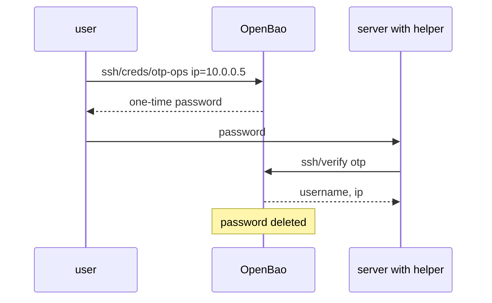

# One-Time Passwords

A server that cannot use certificates can still avoid permanent credentials. In one-time password mode, OpenBao creates a password for one login to one address. A helper on the server checks the password with OpenBao, and the password is deleted after its first use. This part creates a role, requests a password, and checks it the way the helper does.

## Set up your terminal

The commands in this part need the SSH engine.

<!-- astrona:playground:renew -->

Start the port-forward in a second terminal and leave it running:

```sh
kubectl -n openbao port-forward svc/openbao 8200:8200
```

Point `bao` at the server with the lab-only root token:

```sh
export BAO_ADDR=http://openbao.localtest.me:8200
export BAO_TOKEN=$(kubectl -n openbao get secret openbao-init -o jsonpath='{.data.root-token}' | base64 -d)
```

```sh
bao secrets enable ssh
```

If the engine exists, ignore the error.

## Write an OTP role

```sh
bao write ssh/roles/otp-ops key_type=otp default_user=ops cidr_list=10.0.0.0/8
bao read ssh/roles/otp-ops
```

`key_type=otp` makes it a one-time password role. `default_user` is the user on the server. `cidr_list` limits the addresses for which a password may be requested. A request for an address outside the list is refused.

## Request a password

The caller names the address of the server:

```sh
bao write -format=json ssh/creds/otp-ops ip=10.0.0.5 | jq '.data | {username, ip, key, key_type}'
```

The `key` is the one-time password. The caller types it at the SSH password prompt. The answer also contains a lease, so the password expires on its own if nobody uses it.

## What the server does

The server runs `vault-ssh-helper` in its PAM configuration. When a user logs in, the helper sends the typed password to OpenBao at `ssh/verify`. This endpoint needs no token, because the password is the proof. You can send the same request by hand:

```sh
KEY=$(bao write -field=key ssh/creds/otp-ops ip=10.0.0.5)
bao write ssh/verify otp="$KEY"
```

The answer has the `ip` and the `username` that the password was created for, and the server lets the user in. Run the verify a second time with the same key:

```sh
bao write ssh/verify otp="$KEY"
```

It fails, because OpenBao deleted the password after its first use. This is the point of the mode: a password seen in a log or in the terminal cannot be used again.

## Limits of the mode

Every login needs a call to OpenBao, so the server must reach OpenBao at that moment, and the helper must be installed on each server. Certificates need neither. Use OTP for devices that cannot validate certificates, and use certificates for everything else.



The diagram shows that the server asks OpenBao about the password, and that OpenBao forgets it after the first answer.

You can now use both modes of the SSH engine. This completes the module.

## Common pitfalls

> [!WARNING]
> - **Using a wide `cidr_list`.** A role that allows `0.0.0.0/0` hands out passwords for any address.
> - **Letting the server skip the helper for some users.** A user outside the PAM rule can still log in with a password the OS knows.
> - **Forgetting the network path.** If a server cannot reach OpenBao, nobody logs in.

## Your mission: Configure An SSH Certificate Authority Role

You can now set up the SSH engine, write a CA role and restrict it, and issue one-time passwords. The graded lab gives you an enabled SSH engine with no CA key, and asks you to create the CA, write a restricted role, and sign a key through it.

The lab runs in its own cluster, so first pause your playground. Nothing in it is lost:

```sh
astrona stop ats-114-playground-050-02
```

Then start the lab:

```sh
astrona run --git ssh://git@github.com/astrona-io/ATS114.git -c sections/section-050/module-02/labs/lab-01
```

The task is on the next page. Solve it on your own first. When you think you are done, send it for grading:

```sh
astrona submit -c sections/section-050/module-02/labs/lab-01
```

When the lab is done, remove it and start your playground again:

```sh
astrona destroy ats-114-lab-050-02
astrona start ats-114-playground-050-02
```
